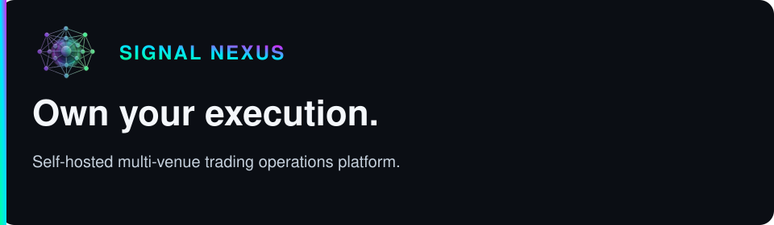
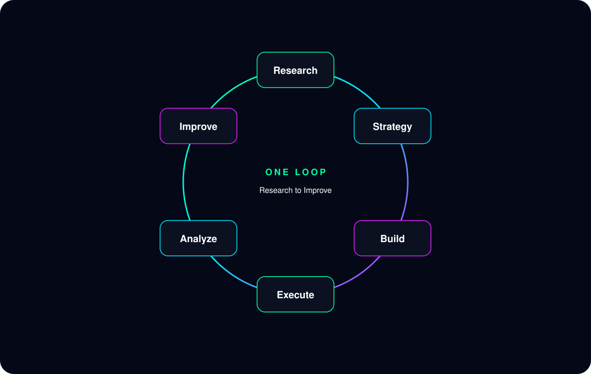
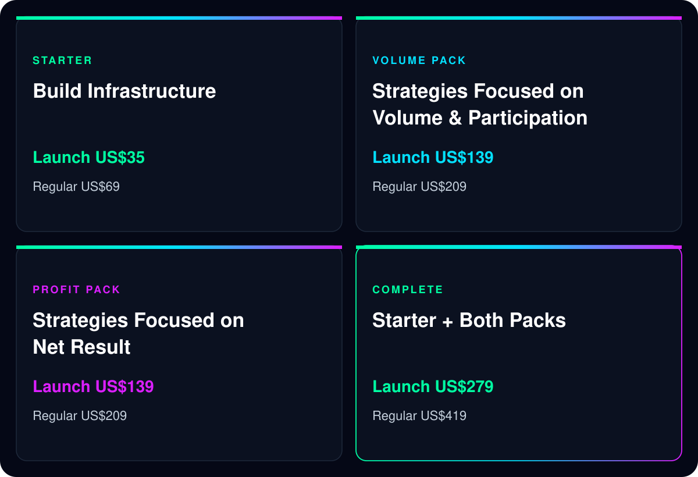
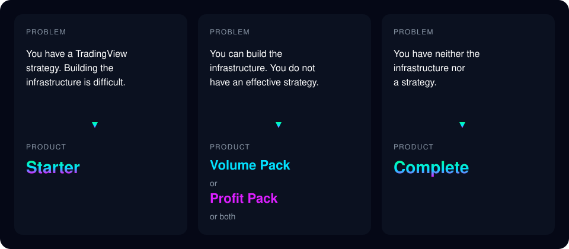

# Signal Nexus

<section>

One Workflow

The alert, the execution, and the record are one run.

</section>

<section>

One Analytics Layer

That record is read in one place.

</section>

<section>

One Risk View

Positions and risk are read from the same record.

</section>

<section>

One Operational Dashboard

That view does not send an order, and it does not remove the risk.

</section>

Less time comparing venues. More time improving the strategy. These four lines stop there.

Own your execution.

Self-hosted multi-venue trading operations platform.

Operate multiple CEXs and DEXs through one workflow.

Your funds, your keys, your infrastructure.

Funds stay at the venue. Keys stay on infrastructure you run. Signal Nexus does not take custody, and it does not take the authority to execute.

This page is the map of Signal Nexus. It says why the platform exists and which product fits. It does not take payment.

## For Japanese Users

Looking for the Japanese version?

Read the Japanese Master LP on note.

<a href="https://note.com/signalnexus/n/n08cc77a0072e" target="_blank" rel="noopener noreferrer">Japanese Master LP</a>

## For Technical Review

Looking for architecture, setup instructions, repository structure, or implementation details?

Read the repository documentation.

<a href="https://github.com/SignalNexus/signal-nexus/blob/main/README.md" target="_blank" rel="noopener noreferrer">README</a>

## Why Signal Nexus Exists

Signal Nexus is not just a tool that turns TradingView alerts into orders.

It is a self-hosted trading operations platform for running more than one venue through one workflow.

Each added venue otherwise means a separate check of positions, profit and loss, risk, orders, and volume. MEXC, Arcus, and other venues are examples of that split. This page does not add a venue. The public release executes on MEXC Spot, MEXC Futures, and Arcus.

The value is not automated trading itself. It is executing a rule you already set, and keeping on executing it. Many traders fail not when creating a strategy, but when repeatedly executing it. A stop-loss comes late. Profit-taking comes early. Rules are changed from emotion. Alerts are missed. Signal Nexus does not decide that the stop is the right stop, or that the strategy is the right strategy. It does not promise a result.

## The Operating Model × Product Mapping

This section shows where each product fits within the Signal Nexus operating model. It is the map of the whole operation. It is not a product comparison. The comparison appears later in Product Catalog.

Signal Nexus is the operating model. The model is one loop:

Research → Strategy → Build → Execute → Analyze → Improve

Free already covers that whole loop. You research, you write the strategy, you build on the public platform, you execute, you read the record, and you decide the next change.

Paid products do not replace the loop. They only fill a missing part of it.

- Starter fills the infrastructure gap. It is the Buildbook and the deployment of the infrastructure you run. It does not execute for you, it does not analyze for you, and it does not improve the strategy for you.
- Volume Pack fills the strategy gap with the purchase-date set selected for trading volume, venue participation, and point-program opportunity. It does not build the infrastructure.
- Profit Pack fills the strategy gap with the purchase-date set selected for net result. It does not build the infrastructure.
- Complete fills both gaps together: the Buildbook, and both strategy sets of the same date. It is not the whole of Signal Nexus. Free still covers the loop. Complete only supplies the two missing pieces in one purchase.

A later date is not included. The rows are not a sequence.

| Product | Research | Strategy | Build | Execute | Analyze | Improve |
| --- | --- | --- | --- | --- | --- | --- |
| Free | Your own research | Your own strategy | Public platform | Execution base | Record and analysis | You improve it |
| Starter | - | - | Buildbook and the deployment | - | - | - |
| Volume Pack | Purchase-date strategy set for trading volume, venue participation, and point-program opportunity | That TradingView strategy set | - | - | - | - |
| Profit Pack | Purchase-date strategy set for net result | That TradingView strategy set | - | - | - | - |
| Complete | Both purchase-date strategy sets | Those TradingView strategy sets | Buildbook and the deployment | - | - | - |

## Start Free

Start with the public repositories first.

Signal Nexus does not require a paid product to get started.

Even with the public repositories alone, you can:

- Research
- Build strategies
- Deploy infrastructure
- Execute trades
- Analyze results
- Improve your process

The paid products do not replace this workflow.

They are designed to fill specific gaps within it.

Start with the public repositories first.

<a href="https://github.com/SignalNexus/signal-nexus" target="_blank" rel="noopener noreferrer">GitHub Repository</a>

## Who It's For

Signal Nexus is designed for:

- Self-directed traders
- Systematic traders
- TradingView users operating across multiple venues
- Builders of self-hosted trading infrastructure
- Traders who want to move from manual execution to repeatable workflows

The next sections say which product fits.

## Product Family Overview

What products exist? The comparison is Product Catalog.

## The Three Problems

Which product fits your problem? This maps a problem to a product. It is not a ranking.

## Product Catalog

This section compares the products, including price. The source text for what each product contains is <a href="https://github.com/SignalNexus/signal-nexus/blob/main/docs/product/PRODUCT_CATALOG.md" target="_blank" rel="noopener noreferrer">Product Catalog</a>. This page does not send you there as the next click. Read More opens that product's Gumroad page. The Gumroad page is where the purchase is made.

Launch Price applies through 2026-12-31 JST. Regular Price applies thereafter. Launch Price is not a sale price.

|  | Starter | Volume Pack | Profit Pack | Complete |
| --- | --- | --- | --- | --- |
| Problem | Strategy exists. Infrastructure is difficult | Infrastructure exists. An effective strategy does not | Infrastructure exists. An effective strategy does not | Neither infrastructure nor a strategy |
| Selection Focus | Infrastructure | Volume & Participation | Net Result | Starter + Both Packs |
| Deliverables | Buildbook | README Strategy Catalog Backtest Results Sample YAML TradingView Setup Guide Pine Source Curated strategy set focused on volume, participation, and program opportunities. | README Strategy Catalog Backtest Results Sample YAML TradingView Setup Guide Pine Source Curated strategy set focused on net results. | Starter Buildbook + Volume Pack of the same date + Profit Pack of the same date Separate Launch Price total: US$313 |
| Launch Price | US$35 | US$139 | US$139 | US$279 |
| Regular Price | US$69 | US$209 | US$209 | US$419 |

Backtest Results remain separate from the Strategy Catalog. Volume Pack and Profit Pack use the same document structure. Their contents differ because each pack contains a different strategy set. Volume Pack contains a curated strategy set focused on volume, participation, and program opportunities. Profit Pack contains a curated strategy set focused on net results. Strategy and venue stay separate. You assign a strategy to a venue in YAML. Complete adds no file of its own.

### Starter

The Buildbook for connecting alerts, execution, and the operational record on infrastructure you run.

Launch Price US$35. Regular Price US$69.

Read more: Gumroad Starter Product LP (URL not set)

### Volume Pack

README, Strategy Catalog, Backtest Results, Sample YAML, TradingView Setup Guide, and Pine source, with a curated strategy set focused on volume, participation, and program opportunities.

Launch Price US$139. Regular Price US$209.

Read more: Gumroad Volume Pack Product LP (URL not set)

### Profit Pack

README, Strategy Catalog, Backtest Results, Sample YAML, TradingView Setup Guide, and Pine source, with a curated strategy set focused on net results.

Launch Price US$139. Regular Price US$209.

Read more: Gumroad Profit Pack Product LP (URL not set)

### Complete

Contains:

- Starter Buildbook
- Volume Pack of the same date
- Profit Pack of the same date

It adds no file of its own.

Separate Launch Price total: US$313. Complete Launch Price: US$279.

Read more: Gumroad Complete Product LP (URL not set)

Past results do not guarantee future results. Nothing here is a recommendation to buy, sell, hold, or avoid an asset or a strategy. Trading can lose money. The terms are in <a href="https://github.com/SignalNexus/signal-nexus/blob/main/DISCLAIMER.md" target="_blank" rel="noopener noreferrer">DISCLAIMER</a>, <a href="https://github.com/SignalNexus/signal-nexus/blob/main/RISK_DISCLOSURE.md" target="_blank" rel="noopener noreferrer">RISK DISCLOSURE</a>, and <a href="https://github.com/SignalNexus/signal-nexus/blob/main/LICENSE.md" target="_blank" rel="noopener noreferrer">LICENSE</a>.

## Before You Start

To operate Signal Nexus, you will need:

- TradingView account
- Supported exchange account
- API credentials
- Infrastructure you manage yourself

### TradingView Requirements

Signal Nexus relies on TradingView alerts.

**A TradingView subscription is required for practical use.**

Available features and alert limits depend on your TradingView plan.

Refer to the <a href="https://www.tradingview.com/pricing/?share_your_love=Lodriguess" target="_blank" rel="noopener noreferrer">TradingView website</a> for current plan details.

### Infrastructure

Signal Nexus is self-hosted.

You are responsible for the infrastructure used to execute orders.

Starter includes a Buildbook that explains how to assemble this infrastructure using free services.

### What Signal Nexus Is

Signal Nexus does not replace TradingView, exchanges, or infrastructure.

It provides a single operating model across them.
