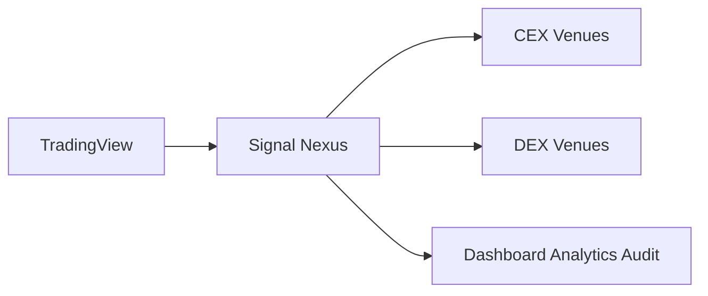

# Signal Nexus

Signal Nexus is a self-hosted trading operations platform. A TradingView alert becomes an order plan that can run across more than one venue. The record, the audit, and the analysis can be operated from one interface.

Your funds stay at the venue. Your keys stay on infrastructure you run.

With `EXECUTION_MODE` unset, the record is kept and the order is not sent. That mode is `dry_run`. `live` sends orders.

The Japanese edition is [README_JA.md](README_JA.md).

## What Signal Nexus Does

TradingView sends an alert. Signal Nexus maps it to a strategy, plans the order, and keeps the operation as a record.

- TradingView signal ingestion. The alert arrives as a webhook and is mapped to a strategy in `config/strategies.yml`.
- Multi-venue execution. One workflow can run that plan on more than one venue. In `dry_run`, the order is not sent.
- Analytics collection. The alert, the plan, and, when an order is sent, the venue result are kept as the operational record.
- Audit notifications. The audit row stays in Postgres. Discord can receive a copy.
- Unified operational workflow. Dashboard, Analytics, and Audit are views of that same run.

You choose the next change. Signal Nexus keeps the record.

## Supported Venues

Current support:

- MEXC Spot
- MEXC Futures
- Arcus

Membership includes future venue additions.

## Architecture



TradingView generates the signal. Signal Nexus receives it and can run it on a CEX venue and a DEX venue. You watch that activity from one operational view.

MEXC is the CEX path. Arcus is the DEX path.

The full layout is in [Architecture](docs/architecture/ARCHITECTURE.md).

## Components

| Component | Role |
| --- | --- |
| TradingView | Sends the alert |
| Webhook | Maps the alert to a strategy and plans the order |
| Venue adapter | Carries a live order to MEXC or Arcus |
| Analytics | Keeps the operational record |
| Postgres | Stores the audit row |
| Portal | Shows Dashboard, Analytics, and Audit |
| Discord | Receives an audit copy |

The Portal is protected by `PORTAL_PASSWORD`, which is supplied through environment configuration.

## Deployment

You deploy Signal Nexus on infrastructure you run.

The webhook process (`app.main`) receives TradingView alerts. Analytics, the audit store, and live order delivery run on a virtual machine you administer (`app.analytics.api`). The Buildbook uses Render for the webhook and Oracle Cloud for that machine.

Leave `EXECUTION_MODE` unset until you intend to send orders. Runtime Modes describes `dry_run`, `live`, and the kill switch.

### Deployment Assumptions

These are the software requirements:

- A Webhook Service capable of running `app.main`
- An Analytics Service capable of running `app.analytics.api`
- A PostgreSQL database reachable by the Analytics Service
- Connectivity from the Webhook Service to the Analytics API through `ANALYTICS_API_URL`

Signal Nexus itself is not tied to Render or Oracle Cloud. The Buildbook uses those two as the reference deployment. The current deployment automation assumes GitHub Actions, SSH to a Linux host as `ubuntu` under `/home/ubuntu`, Caddy serving HTTPS on port 443, PostgreSQL on localhost, and health checks through `RENDER_HEALTH_URL`. Other infrastructure can be used only when those capabilities are present.

### Deployment Relationship

```text
Render Webhook Service
        ↓
ANALYTICS_API_URL
        ↓
Analytics API
        ↓
Postgres

Discord notifications
        ↑
Webhook Service
```

The Webhook Service receives alerts. The Analytics API stores operational records. Postgres persists audit and analytics data. Discord receives audit copies generated by the Webhook Service.

The webhook process uses:

- Build command: `pip install -r requirements.txt`
- Start command: `uvicorn app.main:app --host 0.0.0.0 --port $PORT`

A deployment is ready for the [Strategy Integration Guide](docs/integration/STRATEGY_INTEGRATION_GUIDE.md) when:

1. Webhook `GET /health` returns `{"status":"ok"}`.
2. Analytics API `GET /health` returns `{"status":"ok"}`.
3. `POST /webhook` returns `{"status":"dry_run"}`.

Each health result shows that the process answered.

If you already operate GitHub, Render, a Linux machine, TradingView, and secret management, the process above, Required Configuration, and Strategy Configuration are the public deploy entry.

To reproduce that environment from an empty start, follow the Signal Nexus Buildbook. Starter and Membership include the Buildbook. The Buildbook is the complete deployment playbook.

## Runtime Modes

### dry_run

`EXECUTION_MODE` is unset.

- The audit record is created.
- The analytics record is created.
- Discord notifications are delivered.
- Orders are not sent.

The analytics record is written when `ANALYTICS_API_URL` and `ANALYTICS_API_SECRET` are set. Discord delivery uses `DISCORD_WEBHOOK_URL`. The audit row stays in Postgres.

### live

`EXECUTION_MODE=live`.

- Order execution is enabled.
- Venue orders may be placed.

### Kill Switch

`KILL_SWITCH=true` prevents new order placement.

## Required Configuration

These are the runtime names. This section does not say how to create the values. `EXECUTION_MODE` stays unset for `dry_run`.

### Webhook Service

The webhook process holds these. They authenticate alerts, reach the Analytics API, open the portal, and decide whether an order is sent.

- `WEBHOOK_SECRET` — `POST /webhook` compares this with the JSON field `secret`.
- `ANALYTICS_API_URL` — Where the webhook reaches the Analytics API. The URL carries no secret.
- `ANALYTICS_API_SECRET` — Shared secret for that call. The same value is set on the Analytics service. It is not `WEBHOOK_SECRET`.
- `PORTAL_PASSWORD` — Password for the portal served by the webhook process.
- `DISCORD_WEBHOOK_URL` — Where an audit copy is delivered. The audit row stays in Postgres.
- `KILL_SWITCH` — `true` stops new orders. `false` leaves the order path open.
- `EXECUTION_MODE` — Unset means `dry_run`. `live` sends orders.

### Analytics Service

The Analytics API stores the operational record in Postgres on the virtual machine. This value is in `analytics.env`.

- `ANALYTICS_DB_PASSWORD` — Password of the local Postgres role `signalnexus`.

### Analytics Read Keys

The Analytics service reads positions, fills, and balances. These keys do not send orders. Spot and futures are separate keys. Arcus fills are read without a signature. These values are in `analytics.env`.

- `ANALYTICS_MEXC_API_KEY` — MEXC spot read key.
- `ANALYTICS_MEXC_API_SECRET` — Secret of that read key.
- `ANALYTICS_MEXC_FUTURES_API_KEY` — MEXC futures read key.
- `ANALYTICS_MEXC_FUTURES_API_SECRET` — Secret of that read key.
- `ANALYTICS_ARCUS_ADDRESS` — Address used to read Arcus fills.

### Order Execution Keys

Live orders use a different set of keys from the read keys. Spot and futures stay separate. MEXC order keys have withdrawal off. These MEXC values are in `mexc.env`. Arcus orders are signed with `ARCUS_ADDRESS` and `ARCUS_SIGNING_KEY`, in `arcus.env`. That pair can be the same wallet as `ANALYTICS_ARCUS_ADDRESS`. The signing key is required only for orders.

- `MEXC_API_KEY` — MEXC spot order key.
- `MEXC_API_SECRET` — Secret of that order key.
- `MEXC_FUTURES_API_KEY` — MEXC futures order key.
- `MEXC_FUTURES_API_SECRET` — Secret of that order key.
- `ARCUS_ADDRESS` — Address that signs Arcus orders.
- `ARCUS_SIGNING_KEY` — Signing key for that address.

### Configuration Locations

These definitions identify which Signal Nexus component consumes each value.

They do not prescribe a specific infrastructure implementation.

Webhook Service

- `WEBHOOK_SECRET`
- `ANALYTICS_API_URL`
- `ANALYTICS_API_SECRET`
- `PORTAL_PASSWORD`
- `DISCORD_WEBHOOK_URL`
- `KILL_SWITCH`
- `EXECUTION_MODE`

The Analytics Service reads the same `ANALYTICS_API_SECRET`.

Analytics Service

- `ANALYTICS_DB_PASSWORD`
- `ANALYTICS_MEXC_API_KEY`
- `ANALYTICS_MEXC_API_SECRET`
- `ANALYTICS_MEXC_FUTURES_API_KEY`
- `ANALYTICS_MEXC_FUTURES_API_SECRET`
- `ANALYTICS_ARCUS_ADDRESS`

Order Execution Components

- `MEXC_API_KEY`
- `MEXC_API_SECRET`
- `MEXC_FUTURES_API_KEY`
- `MEXC_FUTURES_API_SECRET`
- `ARCUS_ADDRESS`
- `ARCUS_SIGNING_KEY`

## Deployment Automation Variables

These names belong to the current deployment automation. Deployment Assumptions are the software requirements. The two lists are not the same.

These variables are not part of Signal Nexus runtime configuration and are therefore not listed in Required Configuration.

They are documented in the Buildbook appendices.

- `ANALYTICS_SSH_HOST`, `ANALYTICS_SSH_HOST_FINGERPRINT`, and `ANALYTICS_SSH_PRIVATE_KEY` support GitHub Actions deployment to the Analytics VM.
- `RENDER_HEALTH_URL` supports deployment validation and health verification.
- `CADDY_SITE_ADDRESS` defines the HTTPS hostname used by the Analytics VM deployment.

These variables are deployment transport and infrastructure variables.

They are not Signal Nexus business configuration.

Signal Nexus runtime configuration is fully documented in Required Configuration.

The Buildbook remains the authoritative source for deployment automation variables.

## Strategy Configuration

`config/strategies.yml` maps an alert to an order plan. The key is `strategy_id`. The alert's `strategy_id` and `symbol` must match that row. The order amount is `size_quote` on the row. The alert body does not carry `size` or `size_quote`.

```yaml
btc_long_example:
  symbol: BTC/USDT
  size_quote: 10
  side: long
  venue: mexc_spot
```

`size_quote` is the order amount in USDT. `side` is `long` or `short`. `venue` is `mexc_spot`, `mexc_futures`, or `arcus`. A short row cannot use a spot venue.

## Webhook Payload

`POST /webhook` accepts a JSON body. The secret travels in `secret`. There is no authentication header.

```json
{
  "secret": "your_webhook_secret",
  "strategy_id": "btc_long_example",
  "symbol": "BTC/USDT",
  "action": "BUY",
  "bar_time": "2026-10-16T00:00:00Z",
  "client_order_id": "btc_long_example_20261016000000_buy"
}
```

| Field | Meaning |
| --- | --- |
| `secret` | The same string as `WEBHOOK_SECRET` |
| `strategy_id` | The key in `config/strategies.yml` |
| `symbol` | The `symbol` on that row |
| `action` | An action that row accepts |
| `bar_time` | ISO-8601 time, such as `2026-10-16T00:00:00Z` |
| `client_order_id` | An id for this attempt. A repeat for that venue is discarded |

`exit_bar_close` is optional, and only with `SELL` or `STOP`. It is an ISO-8601 time.

A body that contains `size` or `size_quote` is HTTP 422. The amount stays in `size_quote` on the strategy row.

| Row | Actions |
| --- | --- |
| `side: long` and a spot venue | `BUY`, `SELL`, `STOP` |
| `side: long` and a futures venue | `LONG`, `FLAT` |
| `side: short` and a futures venue | `SHORT`, `COVER` |

Any other action for that row is rejected. One symbol on one venue cannot have both a long row and a short row.

A secret mismatch is HTTP 401 and `{"detail":"unauthorized"}`. A rejected alert is HTTP 422, and the order is not sent. A repeated `client_order_id` is HTTP 200 and `{"status":"duplicate"}`. A match with `EXECUTION_MODE` unset is `{"status":"dry_run"}`. A match with `KILL_SWITCH` set to `true` is `{"status":"killed"}`. A match with `EXECUTION_MODE=live` is `{"status":"accepted"}`, and the order goes to `venue` for `size_quote` USDT.

## Where to go next

| Question | Document |
| --- | --- |
| What does the operator get? | [Product Specification](docs/product/PRODUCT_SPECIFICATION.md) |
| How is the system structured? | [Architecture](docs/architecture/ARCHITECTURE.md) |
| How is TradingView connected? | [Strategy Integration Guide](docs/integration/STRATEGY_INTEGRATION_GUIDE.md) |
| What does each screen show? | [Screen Specification](docs/ui/SCREEN_SPECIFICATION.md) |
| How do the screens connect? | [Screen Relationship Diagram](docs/ui/SCREEN_RELATIONSHIP_DIAGRAM.md) |
| How is a full deployment reproduced? | Signal Nexus Buildbook (Starter or Membership) |
| How do the documents divide? | [Documentation Structure](docs/DOCUMENTATION_STRUCTURE.md) |
