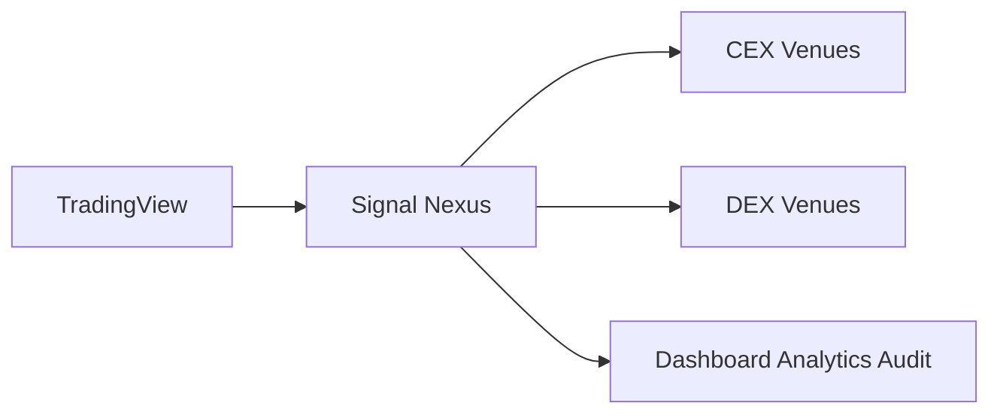

# Signal Nexus

Signal Nexus is a self-hosted trading operations platform. A TradingView alert becomes an order plan that can run across more than one venue. The record, the audit, and the analysis can be operated from one interface.

Your funds stay at the venue. Your keys stay on infrastructure you run. Signal Nexus does not custody assets.

With `EXECUTION_MODE` unset, the record is kept and the order is not sent. That mode is `dry_run`. `live` sends orders.

The Japanese edition is [README_JA.md](README_JA.md).

## What Signal Nexus Does

TradingView sends an alert. Signal Nexus maps it to a strategy, plans the order, and keeps the operation as a record.

- TradingView signal ingestion. The alert arrives as a webhook and is mapped to a strategy in the caller's live `config/strategies.yml`.
- Multi-venue execution. One workflow can run that plan on more than one venue. In `dry_run`, the order is not sent.
- Analytics collection. The alert, the plan, and, when an order is sent, the venue result are kept as the operational record.
- Audit notifications. The audit row stays in Postgres. Discord can receive a copy.
- Unified operational workflow. Dashboard, Analytics, and Audit are views of that same run.

You choose the next change. Signal Nexus keeps the record.

## Supported Venues

Current support:

- MEXC Spot
- MEXC Futures
- Arcus

This public release does not include venues added later.

## Architecture



TradingView generates the signal. Signal Nexus receives it and can run it on a CEX venue and a DEX venue. You watch that activity from one operational view.

Current public release venue adapters are MEXC Spot, MEXC Futures, and Arcus.

The full layout is in [Architecture](docs/architecture/ARCHITECTURE.md).

## Components

| Component | Role |
| --- | --- |
| TradingView | Sends the alert |
| Webhook | Maps the alert to a strategy and plans the order |
| Venue adapter | Carries a live order to MEXC or Arcus |
| Analytics | Keeps the operational record |
| Postgres | Stores the audit row |
| Portal | Shows Dashboard, Analytics, and Audit |
| Discord | Receives an audit copy |

The Portal is protected by `PORTAL_PASSWORD`, which is supplied through environment configuration.

## Deployment

You deploy Signal Nexus on infrastructure you run.

The webhook process (`app.main`) receives TradingView alerts. Analytics, the audit store, and live order delivery run on a Linux host you administer (`app.analytics.api`). The [Community Deployment Guide](docs/COMMUNITY_DEPLOYMENT_GUIDE.md) states the host minimum. `VM.Standard.E2.1.Micro` in Oracle `ap-tokyo-1` is an example shape. The Buildbook shows the console clicks for that example.

Leave `EXECUTION_MODE` unset until you intend to send orders. Runtime Modes describes `dry_run`, `live`, and the kill switch.

### Deployment Assumptions

These are the software requirements:

- A Webhook Service capable of running `app.main`
- An Analytics Service capable of running `app.analytics.api`
- A PostgreSQL database reachable by the Analytics Service
- Connectivity from the Webhook Service to the Analytics API through `ANALYTICS_API_URL`

Signal Nexus itself is not tied to Render or Oracle Cloud. The Community Deployment Guide names those two as an example shape, not as a required purchase. The current deployment automation assumes GitHub Actions, SSH to a Linux host as `ubuntu` under `/home/ubuntu`, Caddy serving HTTPS on port 443, PostgreSQL on localhost, and health checks through `RENDER_HEALTH_URL`. Equivalent infrastructure may also be used when those capabilities are present.

### Deployment Relationship

```text
Render Webhook Service
        ↓
ANALYTICS_API_URL
        ↓
Analytics API
        ↓
Postgres

Discord notifications
        ↑
Webhook Service
```

The Webhook Service receives alerts. The Analytics API stores operational records. Postgres persists audit and analytics data. Discord receives audit copies generated by the Webhook Service.

The caller repository uses the commands in the [Community Deployment Guide](docs/COMMUNITY_DEPLOYMENT_GUIDE.md):

- Build command: `bash render-build.sh && pip install -r .core/requirements.txt`
- Start command: `cd .core && uvicorn app.main:app --host 0.0.0.0 --port $PORT`

A deployment is ready for the [Strategy Integration Guide](docs/integration/STRATEGY_INTEGRATION_GUIDE.md) when:

1. Webhook `GET /health` returns `{"status":"ok"}`.
2. Analytics API `GET /health` returns `{"status":"ok"}`.
3. `POST /webhook` returns `{"status":"dry_run"}`.

Each health result shows that the process answered.

The public authority for that path is the [Community Deployment Guide](docs/COMMUNITY_DEPLOYMENT_GUIDE.md). Follow it through health validation with the public core and the deploy template.

The Buildbook, included with Starter, is the detailed edition of that guide: checklists, screens, FAQ, and failure notes. It does not add a required fact.

## Runtime Modes

### dry_run

`EXECUTION_MODE` is unset.

- The audit record is created.
- The analytics record is created.
- Discord notifications are delivered.
- Orders are not sent.

The analytics record is written when `ANALYTICS_API_URL` and `ANALYTICS_API_SECRET` are set. Discord delivery uses `DISCORD_WEBHOOK_URL`. The audit row stays in Postgres.

### live

`EXECUTION_MODE=live`.

- Order execution is enabled.
- Venue orders may be placed.

### Kill Switch

`KILL_SWITCH=true` prevents new order placement. Render and the virtual machine each read their own value. Render stops a webhook order. The virtual machine stops `/api/mexc/order`, `/api/arcus/order`, `/api/venue/order`, and a protective exit. Set both to `true`, then run the deploy again, before treating the switch as fully closed. `dry_run` stays on Render. The virtual machine remains the live executor.

## Additional venues

`SIGNAL_NEXUS_VENUEADD` names optional venue packages, separated by commas. An empty value leaves MEXC Spot, MEXC Futures, and Arcus unchanged. The module name comes from the setup guide of a venue you installed. The same value is read when that process starts. A reserved id, a repeated id, or a port version other than 1 stops the process instead of skipping the package. One strategy can still list more than one venue.

## Required Configuration

These are the runtime names. This section does not say how to create the values. `EXECUTION_MODE` stays unset for `dry_run`.

### Webhook Service

The webhook process holds these. They authenticate alerts, reach the Analytics API, open the portal, and decide whether an order is sent.

- `WEBHOOK_SECRET` — `POST /webhook` compares this with the JSON field `secret`. A configured value shorter than 24 characters stops this process from starting. `ANALYTICS_API_SECRET` has the same length rule on the process that holds it. `PORTAL_PASSWORD` does not. An unset value stays closed at the request.
- `ANALYTICS_API_URL` — Where the webhook reaches the Analytics API. The URL carries no secret.
- `ANALYTICS_API_SECRET` — Shared secret for that call. The same value is set on the Analytics service. It is not `WEBHOOK_SECRET`.
- `PORTAL_PASSWORD` — Password for the portal served by the webhook process.
- `DISCORD_WEBHOOK_URL` — Where an audit copy is delivered. The audit row stays in Postgres.
- `KILL_SWITCH` — `true` stops new webhook orders. `false` leaves that path open. The same name on the virtual machine stops the order API.
- `EXECUTION_MODE` — Unset means `dry_run`. `live` sends orders.

### Analytics Service

The Analytics API stores the operational record in Postgres on the virtual machine. This value is in `analytics.env`.

- `ANALYTICS_DB_PASSWORD` — Password of the local Postgres role `signalnexus`.

### Analytics Read Keys

The Analytics service reads positions, fills, and balances. These keys do not send orders. Spot and futures are separate keys. Arcus fills are read without a signature. These values are in `analytics.env`.

- `ANALYTICS_MEXC_API_KEY` — MEXC spot read key.
- `ANALYTICS_MEXC_API_SECRET` — Secret of that read key.
- `ANALYTICS_MEXC_FUTURES_API_KEY` — MEXC futures read key.
- `ANALYTICS_MEXC_FUTURES_API_SECRET` — Secret of that read key.
- `ANALYTICS_ARCUS_ADDRESS` — Address used to read Arcus fills.

### Order Execution Keys

Live orders use a different set of keys from the read keys. Spot and futures stay separate. MEXC order keys have withdrawal off. These MEXC values are in `mexc.env`. Arcus orders are signed with `ARCUS_ADDRESS` and `ARCUS_SIGNING_KEY`, in `arcus.env`. That pair can be the same wallet as `ANALYTICS_ARCUS_ADDRESS`. The signing key is required only for orders.

- `MEXC_API_KEY` — MEXC spot order key.
- `MEXC_API_SECRET` — Secret of that order key.
- `MEXC_FUTURES_API_KEY` — MEXC futures order key.
- `MEXC_FUTURES_API_SECRET` — Secret of that order key.
- `ARCUS_ADDRESS` — Address that signs Arcus orders.
- `ARCUS_SIGNING_KEY` — Signing key for that address.

### Configuration Locations

These definitions identify which Signal Nexus component consumes each value.

They do not prescribe a specific infrastructure implementation.

Webhook Service

- `WEBHOOK_SECRET`
- `ANALYTICS_API_URL`
- `ANALYTICS_API_SECRET`
- `PORTAL_PASSWORD`
- `DISCORD_WEBHOOK_URL`
- `KILL_SWITCH`
- `EXECUTION_MODE`

The Analytics Service reads the same `ANALYTICS_API_SECRET`.

Analytics Service

- `ANALYTICS_DB_PASSWORD`
- `ANALYTICS_MEXC_API_KEY`
- `ANALYTICS_MEXC_API_SECRET`
- `ANALYTICS_MEXC_FUTURES_API_KEY`
- `ANALYTICS_MEXC_FUTURES_API_SECRET`
- `ANALYTICS_ARCUS_ADDRESS`

Order Execution Components

- `MEXC_API_KEY`
- `MEXC_API_SECRET`
- `MEXC_FUTURES_API_KEY`
- `MEXC_FUTURES_API_SECRET`
- `ARCUS_ADDRESS`
- `ARCUS_SIGNING_KEY`

## Deployment Automation Variables

These names belong to the current deployment automation. Deployment Assumptions are the software requirements. The two lists are not the same.

These variables are not part of Signal Nexus runtime configuration and are therefore not listed in Required Configuration.

The full set is the nine secrets and the five variables in the [Community Deployment Guide](docs/COMMUNITY_DEPLOYMENT_GUIDE.md). The names below are examples from that set, not the set itself.

- `ANALYTICS_SSH_HOST`, `ANALYTICS_SSH_HOST_FINGERPRINT`, and `ANALYTICS_SSH_PRIVATE_KEY`
- `RENDER_HEALTH_URL`
- `CADDY_SITE_ADDRESS`

These names are deployment transport and infrastructure names.

They are not Signal Nexus business configuration.

The seven runtime files live on the caller repository. The public core does not own them.

The [Community Deployment Guide](docs/COMMUNITY_DEPLOYMENT_GUIDE.md) is the authority for deployment automation names.

## Strategy Configuration

The caller's live `config/strategies.yml` maps an alert to an order plan. Copy it from `config/examples/strategies.yml.example` on `SignalNexus/signal-nexus-deploy`. The key is `strategy_id`. The alert's `strategy_id` and `symbol` must match that row. The order amount is `size_quote` on the row. The alert body does not carry `size` or `size_quote`.

```yaml
btc_long_example:
  symbol: BTC/USDT
  size_quote: 10
  side: long
  venue: mexc_spot
```

`size_quote` is the order amount in USDT. `side` is `long` or `short`. `venue` is `mexc_spot`, `mexc_futures`, or `arcus`. A short row cannot use a spot venue.

### Protective exit

A protective exit is an added function that covers sharp price changes between bars, because a TradingView alert is evaluated only when a bar closes. Signal Nexus keeps one stop price and one take-profit price for each strategy. Those prices are set by applying `loss_pct` and `profit_pct` to that strategy's latest entry fill. Every five seconds, the virtual machine reads a fresh public price and closes that strategy's entire remaining quantity with a market order at the first level the price crosses. It does not replace the alert. It limits an unexpected loss, or secures a profit, until the next bar's alert arrives.

The caller's live `config/protective_exit.yml` is one of the seven required runtime files. A `protective_exit` map on a strategy row replaces the venue map in that file, and the venue map replaces the global map. The winning map is used as a whole.

```yaml
protective_exit:
  enabled: false
  loss_pct: 5
  profit_pct: 20
venues:
  arcus:
    enabled: true
    loss_pct: 5
    profit_pct: 20
```

`enabled: false` at the winning level stores no exit. The strategy's own `enabled` field still decides whether an alert can send an order. When `enabled` is true, at least one of `loss_pct` and `profit_pct` is required. Each is a percent from the entry fill, greater than zero and less than 100. For a long, the stop price is the entry fill times `(100 - loss_pct) / 100`, and the take-profit price is the entry fill times `(100 + profit_pct) / 100`. For a short, the stop price is the entry fill times `(100 + loss_pct) / 100`, and the take-profit price is the entry fill times `(100 - profit_pct) / 100`.

One strategy has one remaining quantity, one protective stop, and one take-profit target. They belong to the strategy, not to individual fills. When a new entry increases an existing position, Signal Nexus re-arms both prices from the latest entry fill and the resolved percents. The exit is not calculated from average position cost. The first level a fresh mark crosses closes the entire remaining strategy quantity. There is no partial take profit, partial stop, or second level. For a long, the stop crosses when the mark is at or below the stop, and the target crosses when the mark is at or above it. For a short, those comparisons are reversed. When one mark crosses both, the stop is the one that closes.

A protective exit is an internal exit on the virtual machine. It is not a TradingView alert. Arming creates no audit record and sends no Discord notification. The exit attempt uses the existing audit events `ACCEPTED`, `SUCCESS`, `FAILED`, and `SKIPPED`. It does not create `SIGNAL RECEIVED`, and Dashboard Latest Alert does not move. A stop writes `protective_exit stop=<stop_price> mark=<trigger_price>`. A take profit writes `protective_exit take_profit=<take_profit_price> mark=<trigger_price>`. `FAILED` and `SKIPPED` append the venue or system cause. The virtual machine writes the audit row and forwards the copy to Render when `AUDIT_COPY_URL` is set. Render delivers Discord. The Discord title is `ORDER ACCEPTED`, `ORDER SUCCESS`, `ORDER FAILED`, or `ORDER NOT SENT`. If the forward is unavailable, the audit row remains and the copy status is Not configured.

The alert body does not carry `protective_exit`, `loss_pct`, or `profit_pct`. The Analytics API reads `KILL_SWITCH` from the virtual machine. `true` there stops a protective exit and refuses `/api/mexc/order`, `/api/arcus/order`, and `/api/venue/order`. The order API also applies the same `side` and action rules as the webhook. A refusal is HTTP 403 and an audit row (`order_not_sent` for the kill switch, `validation_rejected` for a direction mismatch). The audit is skipped if Postgres is down. The order is still refused.

## Webhook Payload

`POST /webhook` accepts a JSON body. The secret travels in `secret`. There is no authentication header.

```json
{
  "secret": "your_webhook_secret",
  "strategy_id": "btc_long_example",
  "symbol": "BTC/USDT",
  "action": "BUY",
  "bar_time": "2026-10-16T00:00:00Z",
  "client_order_id": "btc_long_example_20261016000000_buy"
}
```

| Field | Meaning |
| --- | --- |
| `secret` | The same string as `WEBHOOK_SECRET` |
| `strategy_id` | The key in `config/strategies.yml` |
| `symbol` | The `symbol` on that row |
| `action` | An action that row accepts |
| `bar_time` | ISO-8601 time within `MAX_BAR_AGE_SECONDS` of the server clock, before or after. The default is 24 hours (86400 seconds). An older or further-future value is HTTP 422 |
| `client_order_id` | An id for this attempt. A repeat for that venue is discarded |

`exit_bar_close` is optional, and only with `SELL` or `STOP`. It is an ISO-8601 time.

A body that contains `size` or `size_quote` is HTTP 422. The amount stays in `size_quote` on the strategy row.

| Row | Actions |
| --- | --- |
| `side: long` and a spot venue | `BUY`, `SELL`, `STOP` |
| `side: long` and a futures venue | `LONG`, `FLAT` |
| `side: short` and a futures venue | `SHORT`, `COVER` |

Any other action for that row is rejected. One symbol on one venue cannot have both a long row and a short row.

A secret mismatch is HTTP 401 and `{"detail":"unauthorized"}`. A rejected alert is HTTP 422, and the order is not sent. A repeated `client_order_id` is HTTP 200 and `{"status":"duplicate"}`. A match with `EXECUTION_MODE` unset is `{"status":"dry_run"}`. A match with `KILL_SWITCH` set to `true` is `{"status":"killed"}`. A match with `EXECUTION_MODE=live` is `{"status":"accepted"}`, and the order goes to `venue` for `size_quote` USDT.

## Where to go next

| Question | Document |
| --- | --- |
| What does the operator get? | [Product Specification](docs/product/PRODUCT_SPECIFICATION.md) |
| How is the system structured? | [Architecture](docs/architecture/ARCHITECTURE.md) |
| How is TradingView connected? | [Strategy Integration Guide](docs/integration/STRATEGY_INTEGRATION_GUIDE.md) |
| What does each screen show? | [Screen Specification](docs/ui/SCREEN_SPECIFICATION.md) |
| How do the screens connect? | [Screen Relationship Diagram](docs/ui/SCREEN_RELATIONSHIP_DIAGRAM.md) |
| How is a full deployment reproduced? | [Community Deployment Guide](docs/COMMUNITY_DEPLOYMENT_GUIDE.md). The Buildbook is the optional detailed edition |
| How do the documents divide? | [Documentation Structure](docs/DOCUMENTATION_STRUCTURE.md) |

## Legal

Signal Nexus Community Edition is source-available software. You may read the source, learn from it, use it in teaching and non-commercial research, and run it for your own personal use. The author keeps the copyright, the brand, and every commercial right. This edition is published under its own license, not under an open-source license. English is the canonical text.

- [LICENSE](LICENSE.md)
- [DISCLAIMER](DISCLAIMER.md)
- [RISK DISCLOSURE](RISK_DISCLOSURE.md)

The Japanese editions are [LICENSE_JA.md](LICENSE_JA.md), [DISCLAIMER_JA.md](DISCLAIMER_JA.md), and [RISK_DISCLOSURE_JA.md](RISK_DISCLOSURE_JA.md).

## Security

Report a vulnerability in private, through the [Security Policy](SECURITY.md). The Japanese edition is [SECURITY_JA.md](SECURITY_JA.md).
