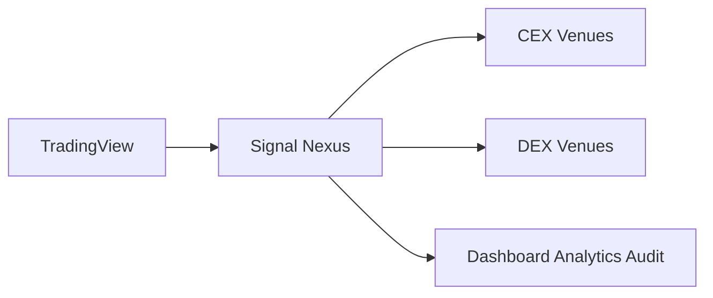

# Signal Nexus

Signal Nexus は、自分でホストする取引の運用プラットフォームです。TradingView のアラートは発注の計画になり、複数の取引所へ実行できます。記録、監査、分析は、１つのインターフェースで運用が可能となります。

資金は、使っている取引所の口座に残ります。鍵は、自分で動かしている環境に残ります。

`EXECUTION_MODE` を設定しないあいだは、記録は残り、注文は出ません。この状態が `dry_run` です。`live` で注文を出します。

英語版 [README.md](README.md) が原文です。

## Signal Nexus がすること

TradingView がアラートを送ります。Signal Nexus はそれを戦略に割り当て、発注の計画を作り、運用の記録として残します。

- TradingView のシグナル取り込み。アラートは Webhook として届き、`config/strategies.yml` の戦略に割り当てられます。
- 複数の取引所への実行。一つの運用で、その計画を複数の取引所へ出せます。`dry_run` では注文は出ません。
- Analytics の収集。アラート、計画、注文を出したときの取引所の結果が、運用の記録として残ります。
- 監査の通知。監査の行は Postgres に残ります。Discord へ写しを届けられます。
- 一つの運用の流れ。Dashboard、Analytics、Audit は、同じ運用の見え方です。

次に何を変えるかは、自分で決めます。Signal Nexus は記録を残します。

## 対応する取引所

いま対応している取引所:

- MEXC 現物
- MEXC 先物
- Arcus

Membership には、今後追加される取引所が含まれます。

## 構成



TradingView がシグナルを出します。Signal Nexus が受け取り、CEX と DEX へ実行できます。その動きは、一つの運用の画面から見ます。

いまの CEX は MEXC です。いまの DEX は Arcus です。

構成の全体は [Architecture](docs/architecture/ARCHITECTURE_JA.md) にあります。

## 部品

| 部品 | 役割 |
| --- | --- |
| TradingView | アラートを送る |
| Webhook | アラートを戦略に割り当て、発注の計画を作る |
| 取引所アダプター | `live` の注文を MEXC または Arcus へ渡す |
| Analytics | 運用の記録を残す |
| Postgres | 監査の行を保存する |
| ポータル | Dashboard、Analytics、Audit を表示する |
| Discord | 監査の写しを受け取る |

ポータルは `PORTAL_PASSWORD` で保護されます。値は環境の設定で渡します。

## デプロイ

Signal Nexus は、自分の環境へデプロイします。

Webhook のプロセス（`app.main`）が TradingView のアラートを受けます。Analytics、監査の保存、`live` の発注は、自分で管理する仮想マシン（`app.analytics.api`）で動きます。Buildbook では、Webhook に Render、仮想マシンに Oracle Cloud を使います。

注文を出すと決めるまで、`EXECUTION_MODE` は入れません。`dry_run`、`live`、Kill Switch は、実行モードにあります。

### デプロイの前提

これは、ソフトウェアの要件です。

- `app.main` を動かせる Webhook サービス
- `app.analytics.api` を動かせる Analytics サービス
- Analytics サービスから届く PostgreSQL
- Webhook サービスから Analytics API へ、`ANALYTICS_API_URL` で届く接続

Signal Nexus 自体は、Render にも Oracle Cloud にも縛られません。Buildbook が参照するデプロイは、その二つです。いまのデプロイ自動化は、GitHub Actions、`ubuntu` として `/home/ubuntu` へ SSH する Linux ホスト、443 で HTTPS を出す Caddy、localhost の PostgreSQL、`RENDER_HEALTH_URL` による health の確認を前提にします。別のインフラを使うときは、同じ能力が揃っている場合だけです。

### デプロイの関係

```text
Render Webhook Service
        ↓
ANALYTICS_API_URL
        ↓
Analytics API
        ↓
Postgres

Discord notifications
        ↑
Webhook Service
```

Webhook サービスがアラートを受けます。Analytics API が運用の記録を残します。Postgres が監査と Analytics のデータを保持します。Discord は、Webhook サービスが作った監査の写しを受け取ります。

Webhook のプロセスは次です。

- Build command: `pip install -r requirements.txt`
- Start command: `uvicorn app.main:app --host 0.0.0.0 --port $PORT`

次の三つが揃うと、[Strategy Integration Guide](docs/integration/STRATEGY_INTEGRATION_GUIDE_JA.md) へ進めます。

1. Webhook の `GET /health` が `{"status":"ok"}` になる。
2. Analytics API の `GET /health` が `{"status":"ok"}` になる。
3. `POST /webhook` が `{"status":"dry_run"}` になる。

health が示すのは、そのプロセスが応答したことです。

GitHub、Render、Linux のマシン、TradingView、secret の扱いに慣れている場合、上のプロセスと、必要な設定、戦略の設定が、公開されているデプロイの入口です。

何も無い状態からその環境を再現するには、Signal Nexus Buildbook に従います。Starter と Membership に Buildbook が含まれます。Buildbook は、完全な構築の手順書です。

## 実行モード

### dry_run

`EXECUTION_MODE` は未設定です。

- 監査の記録が残ります。
- Analytics の記録が残ります。
- Discord へ通知が届きます。
- 注文は出ません。

Analytics の記録は、`ANALYTICS_API_URL` と `ANALYTICS_API_SECRET` があるときに書かれます。Discord へ届けるときは `DISCORD_WEBHOOK_URL` を使います。監査の行は Postgres に残ります。

### live

`EXECUTION_MODE=live` です。

- 発注が有効になります。
- 取引所へ注文が出ることがあります。

### Kill Switch

`KILL_SWITCH=true` は、新しい注文を止めます。

## 必要な設定

次は、実行時の名前です。値の作り方は書きません。`dry_run` では `EXECUTION_MODE` を未設定のままにします。

### Webhook サービス

Webhook のプロセスが持ちます。アラートの確認、Analytics API への到達、ポータルを開くこと、注文を出すかどうかが、ここにあります。

- `WEBHOOK_SECRET` — `POST /webhook` が、JSON の `secret` とこの値を比べます。
- `ANALYTICS_API_URL` — Webhook が Analytics API に届く先です。URL に秘密は入れません。
- `ANALYTICS_API_SECRET` — その呼び出しの共有の秘密です。同じ値を Analytics サービスにも置きます。`WEBHOOK_SECRET` とは別です。
- `PORTAL_PASSWORD` — Webhook のプロセスが出すポータルのパスワードです。
- `DISCORD_WEBHOOK_URL` — 監査の写しの届け先です。監査の行は Postgres に残ります。
- `KILL_SWITCH` — `true` で新しい注文を止めます。`false` では発注の経路を開いたままにします。
- `EXECUTION_MODE` — 未設定は `dry_run` です。`live` で注文を出します。

### Analytics サービス

Analytics API は、仮想マシンの Postgres に運用の記録を残します。この値は `analytics.env` にあります。

- `ANALYTICS_DB_PASSWORD` — ローカル Postgres のロール `signalnexus` のパスワードです。

### Analytics の読み取りキー

Analytics サービスは、ポジション、約定、残高を読みます。これらのキーでは注文を出しません。現物と先物は別のキーです。Arcus の約定は、署名せずに読みます。これらの値は `analytics.env` にあります。

- `ANALYTICS_MEXC_API_KEY` — MEXC 現物の読み取りキーです。
- `ANALYTICS_MEXC_API_SECRET` — その秘密です。
- `ANALYTICS_MEXC_FUTURES_API_KEY` — MEXC 先物の読み取りキーです。
- `ANALYTICS_MEXC_FUTURES_API_SECRET` — その秘密です。
- `ANALYTICS_ARCUS_ADDRESS` — Arcus の約定を読むアドレスです。

### 発注キー

`live` の注文は、読み取りキーとは別の組を使います。現物と先物は分けたままです。MEXC の発注キーは、出金を無効にします。MEXC の値は `mexc.env` にあります。Arcus の注文は `ARCUS_ADDRESS` と `ARCUS_SIGNING_KEY` で署名します。この組は `arcus.env` にあります。`ANALYTICS_ARCUS_ADDRESS` と同じウォレットでもかまいません。署名鍵が要るのは注文だけです。

- `MEXC_API_KEY` — MEXC 現物の発注キーです。
- `MEXC_API_SECRET` — その秘密です。
- `MEXC_FUTURES_API_KEY` — MEXC 先物の発注キーです。
- `MEXC_FUTURES_API_SECRET` — その秘密です。
- `ARCUS_ADDRESS` — Arcus の注文に署名するアドレスです。
- `ARCUS_SIGNING_KEY` — そのアドレスの署名鍵です。

### 設定の置き場所

これらの定義は、Signal Nexus のどの部品がどの値を読むかを示します。

特定のインフラの実装は定めません。

Webhook サービス

- `WEBHOOK_SECRET`
- `ANALYTICS_API_URL`
- `ANALYTICS_API_SECRET`
- `PORTAL_PASSWORD`
- `DISCORD_WEBHOOK_URL`
- `KILL_SWITCH`
- `EXECUTION_MODE`

Analytics サービスは、同じ `ANALYTICS_API_SECRET` を読みます。

Analytics サービス

- `ANALYTICS_DB_PASSWORD`
- `ANALYTICS_MEXC_API_KEY`
- `ANALYTICS_MEXC_API_SECRET`
- `ANALYTICS_MEXC_FUTURES_API_KEY`
- `ANALYTICS_MEXC_FUTURES_API_SECRET`
- `ANALYTICS_ARCUS_ADDRESS`

発注の部品

- `MEXC_API_KEY`
- `MEXC_API_SECRET`
- `MEXC_FUTURES_API_KEY`
- `MEXC_FUTURES_API_SECRET`
- `ARCUS_ADDRESS`
- `ARCUS_SIGNING_KEY`

## デプロイ自動化の変数

これらの名前は、いまのデプロイ自動化のものです。デプロイの前提は、ソフトウェアの要件です。二つの一覧は別です。

これらの変数は、Signal Nexus の実行時の設定ではありません。そのため、必要な設定には入れていません。

文書は、Buildbook の別紙にあります。

- `ANALYTICS_SSH_HOST`、`ANALYTICS_SSH_HOST_FINGERPRINT`、`ANALYTICS_SSH_PRIVATE_KEY` は、GitHub Actions から Analytics の仮想マシンへデプロイするために使います。
- `RENDER_HEALTH_URL` は、デプロイの確認と health の確認に使います。
- `CADDY_SITE_ADDRESS` は、Analytics の仮想マシンのデプロイが使う HTTPS のホスト名です。

これらの変数は、デプロイの輸送とインフラの変数です。

Signal Nexus の業務設定ではありません。

Signal Nexus の実行時の設定は、必要な設定にすべて書いてあります。

デプロイ自動化の変数の正本は、Buildbook です。

## 戦略の設定

`config/strategies.yml` が、アラートを発注の計画に割り当てます。キーが `strategy_id` です。アラートの `strategy_id` と `symbol` は、その行と一致させます。注文額は、その行の `size_quote` です。アラートの本文に `size` も `size_quote` も入れません。

```yaml
btc_long_example:
  symbol: BTC/USDT
  size_quote: 10
  side: long
  venue: mexc_spot
```

`size_quote` は USDT 建ての注文額です。`side` は `long` または `short` です。`venue` は `mexc_spot`、`mexc_futures`、`arcus` です。`short` の行は、現物には置けません。

## Webhook の本文

`POST /webhook` は JSON を受けます。秘密は `secret` に載せます。認証ヘッダはありません。

```json
{
  "secret": "your_webhook_secret",
  "strategy_id": "btc_long_example",
  "symbol": "BTC/USDT",
  "action": "BUY",
  "bar_time": "2026-10-16T00:00:00Z",
  "client_order_id": "btc_long_example_20261016000000_buy"
}
```

| 欄 | 意味 |
| --- | --- |
| `secret` | `WEBHOOK_SECRET` と同じ文字列 |
| `strategy_id` | `config/strategies.yml` のキー |
| `symbol` | その行の `symbol` |
| `action` | その行が受け付けるアクション |
| `bar_time` | ISO-8601 の時刻。例は `2026-10-16T00:00:00Z` |
| `client_order_id` | その一回の id。同じ venue での再送は破棄される |

`exit_bar_close` は任意で、`SELL` または `STOP` のときだけです。こちらも ISO-8601 の時刻です。

本文に `size` または `size_quote` があると、HTTP 422 です。金額は戦略の行の `size_quote` に残します。

| 行 | アクション |
| --- | --- |
| `side: long` で現物 | `BUY`、`SELL`、`STOP` |
| `side: long` で先物 | `LONG`、`FLAT` |
| `side: short` で先物 | `SHORT`、`COVER` |

それ以外のアクションは、その行では拒否されます。同じ取引所の同じシンボルに、long の行と short の行を同時には置けません。

`secret` が違うときは HTTP 401 で、本文は `{"detail":"unauthorized"}` です。拒否されたアラートは HTTP 422 で、注文は出ません。同じ `client_order_id` の再送は HTTP 200 と `{"status":"duplicate"}` です。`EXECUTION_MODE` が未設定の一致は `{"status":"dry_run"}` です。`KILL_SWITCH` が `true` の一致は `{"status":"killed"}` です。`EXECUTION_MODE=live` の一致は `{"status":"accepted"}` で、`venue` へ `size_quote` USDT の注文を出します。

## 次に読むもの

| 知りたいこと | 文書 |
| --- | --- |
| 利用者の手元に何が残るか | [Product Specification](docs/product/PRODUCT_SPECIFICATION_JA.md) |
| システムがどう構成されているか | [Architecture](docs/architecture/ARCHITECTURE_JA.md) |
| TradingView をどう繋ぐか | [Strategy Integration Guide](docs/integration/STRATEGY_INTEGRATION_GUIDE_JA.md) |
| 各画面に何が出るか | [Screen Specification](docs/ui/SCREEN_SPECIFICATION_JA.md) |
| 画面がどう繋がるか | [Screen Relationship Diagram](docs/ui/SCREEN_RELATIONSHIP_DIAGRAM_JA.md) |
| 一通りのデプロイをどう再現するか | Signal Nexus Buildbook（Starter または Membership） |
| 文書がどう分かれるか | [Documentation Structure](docs/DOCUMENTATION_STRUCTURE_JA.md) |
