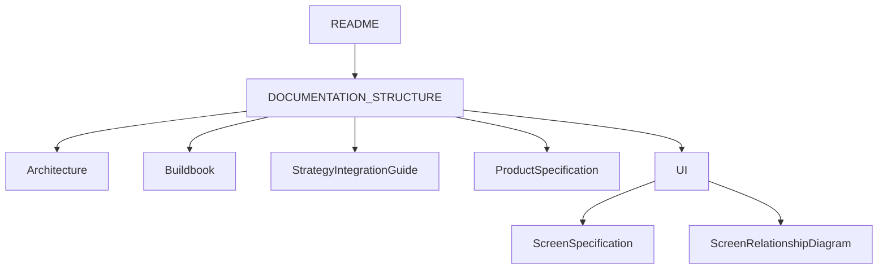
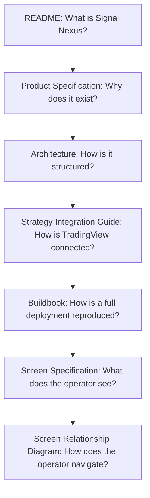

# Signal Nexus Documentation Structure

Before reading any document, start here.

This document defines the role and responsibility of every canonical document in the Signal Nexus documentation set.

Each document should focus only on its own responsibility and avoid repeating the responsibilities of other documents.

English is the canonical text. The Japanese edition is [DOCUMENTATION_STRUCTURE_JA.md](DOCUMENTATION_STRUCTURE_JA.md).

## Documents

| Document | Access | Purpose | Contains | Does not contain |
| --- | --- | --- | --- | --- |
| Architecture | Public | Canonical system layout | Components, data flow, public and private boundary | Install steps, screen fields, product lineup |
| Buildbook | Starter / Membership | Canonical build procedure | Accounts, the virtual machine, secrets, deploy, validation | Portal screens, strategy rules, research |
| Strategy Integration Guide | Public | Canonical TradingView connection | `strategy_id`, alert payload, webhook contract | Signal logic, indicator design, research |
| Screen Specification | Public | Canonical screen content | Purpose, what the user can learn, displayed information, navigation of each view | API design, database design, build steps |
| Screen Relationship Diagram | Public | Canonical screen navigation | The view tree and the jumps between views | Field lists, build steps |
| Product Specification | Public | Canonical product description | What the operator gets, venues, lineup names | Install steps, screen label definitions, prices |
| README | Public | Deploy entry | Repository commands, Render build and start, the three validation checks | The tables in this file, install tutorials, screen specifications |

Buildbook is the only canonical document that is not part of the public documentation set. Buildbook is available through Starter and all Membership tiers.

Buildbook is not required to deploy Signal Nexus. Buildbook exists for operators who need a complete, step-by-step deployment and operational guide. README is the public deploy entry. Buildbook is the complete deployment playbook.

## Documentation availability

Public documentation:

- README
- Architecture
- Strategy Integration Guide
- Screen Specification
- Screen Relationship Diagram
- Product Specification

Starter documentation:

- Buildbook

Membership documentation:

- Alpha Membership includes the Buildbook and venue-expansion materials.
- Beta Membership includes everything in Alpha Membership, plus research-expansion materials.

## Access by tier

Alpha Membership includes Starter. Beta Membership includes Alpha Membership.

| Material | Starter | Alpha Membership | Beta Membership |
| --- | --- | --- | --- |
| Buildbook | ✅ | ✅ | ✅ |
| Research materials | ❌ | ❌ | ✅ |
| Venue-expansion materials | ❌ | ✅ | ✅ |

Research materials are research releases, validation reports, and strategy updates. Venue-expansion materials are venue adapters and venue onboarding materials.

## Product relationship

Signal Nexus documentation is available through different access levels.

### Free

Public documentation and the open-source platform.

Includes:

- README
- Architecture
- Strategy Integration Guide
- Screen Specification
- Screen Relationship Diagram
- Product Specification

### Starter

Buildbook access.

Includes:

- Buildbook

### Alpha Membership

Includes everything in Starter, plus venue-expansion materials.

Includes:

- Buildbook
- Venue adapters
- Venue onboarding materials
- Membership-specific materials

### Beta Membership

Includes everything in Alpha Membership, plus research-expansion materials.

Includes:

- Buildbook
- Venue adapters
- Venue onboarding materials
- Research releases
- Validation reports
- Strategy updates
- Membership-specific materials

## Common reading paths

I am evaluating Signal Nexus.

README → Product Specification → Architecture

I want to understand the platform.

README → Architecture → Product Specification

I want to operate multiple venues.

README → Architecture → Screen Specification

I want to understand the user experience.

README → Screen Relationship Diagram → Screen Specification

I want to deploy Signal Nexus.

Start with README.

README contains the public deployment entry and validation flow.

If README is sufficient for your environment and experience level, no additional documentation is required.

If you need a complete end-to-end deployment guide, including:

- account creation
- cloud setup
- networking
- security configuration
- secrets management
- backup configuration
- deployment validation
- operational guidance

then Starter or Membership is required.

→ Buildbook

I want to connect TradingView.

README → Strategy Integration Guide

## Relationship



```text
README
  |
  v
DOCUMENTATION_STRUCTURE
  |
  +-- Architecture
  +-- Buildbook
  +-- Strategy Integration Guide
  +-- Product Specification
  +-- UI
        +-- Screen Specification
        +-- Screen Relationship Diagram
```

## Documentation responsibility flow

README answers what Signal Nexus is.

Product Specification answers why it exists.

Architecture answers how it is structured.

Strategy Integration Guide answers how TradingView is connected.

README is the public deploy entry. Buildbook answers how a deployment is reproduced from an empty start. Access to Buildbook is Starter or Membership.

Screen Specification answers what the operator sees.

Screen Relationship Diagram answers how the operator navigates.



