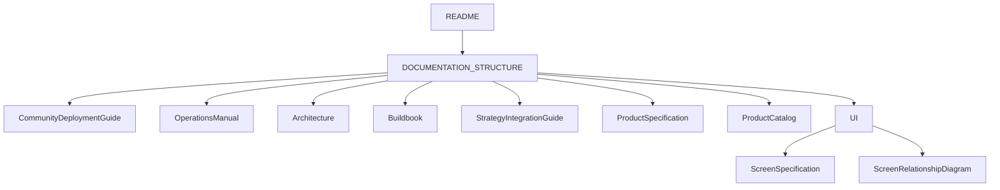
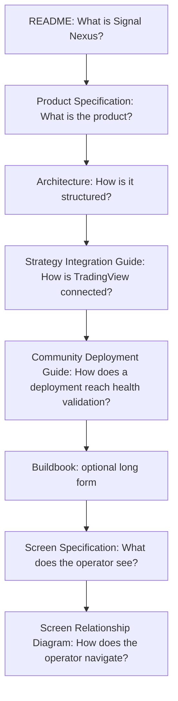

# Signal Nexus Documentation Structure

Before reading any document, start here.

This document defines the role and responsibility of every canonical document in the Signal Nexus documentation set.

Each document should focus only on its own responsibility and avoid repeating the responsibilities of other documents.

English is the canonical text. The Japanese edition is [DOCUMENTATION_STRUCTURE_JA.md](DOCUMENTATION_STRUCTURE_JA.md).

## Documents

| Document | Access | Purpose | Contains | Does not contain |
| --- | --- | --- | --- | --- |
| Architecture | Public | Canonical system layout | Components, data flow, public and private boundary | Install steps, screen fields, product lineup |
| Community Deployment Guide | Public | Canonical deploy path | Caller repository, seven runtime files, secrets, variables, health validation | Console screens, a customer registry, FAQ |
| Operations Manual | Public | Binder of the thirteen chapters | The chapter table and the reading path | Install clicks, a customer registry |
| Customer Lifecycle | Public | One environment | One caller repository, one pin, one recommended SHA, empty manifest until a purchase | Host clicks, secret values |
| Customer Creation | Public | Caller bootstrap | Template, seven runtime files, `confirm`, `venues: []` | Nine secret values, `workflow_dispatch` |
| Infrastructure Execution | Public | Host and Render | Linux host, PostgreSQL 16, Render Web Service, nine secrets, five variables | `workflow_dispatch` |
| Deployment Readiness | Public | First and later dispatch | Checklist, health, seven SHA256 values | Console screens |
| Launch Gate | Public | Frozen start state | Recorded pin, hashes, host and Render account blockers | A created VM |
| Release Management | Public | Public tag and pin move | Release gate, export, recommended SHA | A customer host |
| Venue License | Public | Paid venue access | Manifest, Read, `VENUEADD_READ_TOKEN` | A required install for first health |
| AddVenue Operations | Public | One manifest row after first success | Worked case, refund | txflow introduction |
| Troubleshooting | Public | Failures on the guide path | Futures read on `none`, pin mismatch, fetch that does not restart | Console recovery |
| Rollback | Public | That caller only | First-deploy failure, later-deploy failure | Another caller repository |
| Buildbook | Starter | Long form of the Community Deployment Guide | Console clicks, checklists, screens, FAQ, failure notes | A required fact that the guide does not state |
| Strategy Integration Guide | Public | Canonical TradingView connection | `strategy_id`, alert payload, webhook contract | Signal logic, indicator design, research |
| Screen Specification | Public | Canonical screen content | Purpose, what the user can learn, displayed information, navigation of each view | API design, database design, build steps |
| Screen Relationship Diagram | Public | Canonical screen navigation | The view tree and the jumps between views | Field lists, build steps |
| Product Specification | Public | Canonical product definition | What the operator gets, venues, lineup names | Install steps, screen label definitions, prices, which sales page to open |
| Product Catalog | Public | Comparison source | Lineup comparison, which problem each product answers | Prices, checkout, the GitHub Pages home, the product definition |
| index.md | Public | GitHub Pages home | Why Signal Nexus exists, the three problems, one workflow, the comparison section | Checkout, Buildbook steps, deployment commands |
| starter/index.html | Public | Starter product page | What Starter is, the published price, Stripe Checkout | A lineup comparison, Buildbook steps |
| volume-pack/index.html | Public | Volume Pack product page | What that purchase date contains, the published price, Stripe Checkout | A lineup comparison, the strategy source |
| profit-pack/index.html | Public | Profit Pack product page | What that purchase date contains, the published price, Stripe Checkout | A lineup comparison, the strategy source |
| complete/index.html | Public | Complete product page | The bundle of one date, the published price, Stripe Checkout | A lineup comparison, a Complete repository |
| README | Public | Repository documentation for people who run the source | What Signal Nexus is, runtime modes, configuration, the webhook and strategy summary, build and start commands, the three validation checks | A sales page, a product catalog, checkout |
| LICENSE | Public | Community Edition license | Permissions, prohibitions, brand, reserved commercial rights | Trading-risk narrative, vulnerability-reporting steps |
| DISCLAIMER | Public | Offer terms for the Community Edition | Advice boundary, no asset management, no profit guarantee, warranty, liability, third parties | The copyright grant |
| RISK_DISCLOSURE | Public | Cryptocurrency and perpetual-market risks | Market, leverage, liquidity, liquidation, venue, contract, infrastructure, operation, regulation, how a stored result can differ | A guarantee of profit |
| SECURITY | Public | Vulnerability-reporting policy | How to report, scope, disclosure, response | A bug bounty |

The Community Deployment Guide is the public authority for deployment. The Operations Manual is the binder of thirteen chapters. Chapters 03, 04, 05, 07, and 09 expand the guide. They do not replace it. Buildbook is the only canonical document that is not part of the public documentation set. Buildbook is included with Starter.

Buildbook is not required to deploy Signal Nexus. It is the long form of the Community Deployment Guide. README is the public entry point. The guide is the path through health validation. Chapter 13 stays in `business/consideration/design/` and is not exported.

## Documentation availability

Public documentation:

- README
- Community Deployment Guide
- Operations Manual
- Customer Lifecycle
- Customer Creation
- Infrastructure Execution
- Deployment Readiness
- Launch Gate
- Release Management
- Venue License
- AddVenue Operations
- Troubleshooting
- Rollback
- Architecture
- Strategy Integration Guide
- Screen Specification
- Screen Relationship Diagram
- Product Specification
- Product Catalog
- Starter product page
- Volume Pack product page
- Profit Pack product page
- Complete product page
- LICENSE
- DISCLAIMER
- RISK_DISCLOSURE
- SECURITY

Starter documentation:

- Buildbook

Commercial packaging may evolve over time. The canonical definition of currently available products is maintained in [Product Specification](product/PRODUCT_SPECIFICATION.md).

## Access by product

This section records which materials a current product includes. It does not define the product.

Products are independent. Complete is the bundle of Starter and the Volume Pack and Profit Pack of the same date. It is not a higher edition of either pack. VenueAdd is the extension for one venue, including later maintenance of that same venue. It is not a right to every later venue, and it does not include the other products.

| Material | Starter | Volume Pack | Profit Pack | Complete | VenueAdd |
| --- | --- | --- | --- | --- | --- |
| Buildbook | ✅ | ❌ | ❌ | ✅ | ❌ |
| Research materials | ❌ | ✅ | ✅ | ✅ | ❌ |
| Venue-expansion materials | ❌ | ❌ | ❌ | ❌ | ✅ |

Complete includes Buildbook because Complete includes Starter. Volume Pack and Profit Pack include separate research materials. Complete includes both of the same date. VenueAdd includes the venue-expansion materials for that one venue, including later maintenance of the same venue.

## Product relationship

README is the public entry point. Public documentation does not require Starter. Buildbook is Starter material. The table above maps access for the current products. Product Specification is the canonical product definition.

## Common reading paths

I am evaluating Signal Nexus.

README → Product Specification → Architecture

I am choosing which product to read.

README → Product Catalog → Product Specification

I want to understand the platform.

README → Architecture → Product Specification

I want to operate multiple venues.

README → Architecture → Screen Specification

I want to understand the user experience.

README → Screen Relationship Diagram → Screen Specification

I want to deploy Signal Nexus.

README → Community Deployment Guide

The guide is the public path through health validation. Architecture is the reference for the component layout. The Operations Manual names the thirteen chapters. Chapters 02 through 09 expand a later procedure. They do not replace the guide.

The Buildbook is optional. It adds detail, checklists, screens, FAQ, and failure notes. It does not add a required fact.

→ Buildbook

I want to connect TradingView.

README → Strategy Integration Guide

## Relationship



```text
README
  |
  v
COMMUNITY_DEPLOYMENT_GUIDE
  |
  +-- Architecture
  +-- Buildbook, optional
```

## Documentation responsibility flow

README answers what Signal Nexus is.

Product Specification answers what the product is.

Product Catalog answers which product to read, and which product page to open. It does not set a price and it does not take payment. The product page states the published price and opens Stripe Checkout. The home page does not take payment.

Architecture answers how it is structured.

Strategy Integration Guide answers how TradingView is connected.

README is the public entry point. The Community Deployment Guide answers how a deployment reaches health validation. Buildbook is the optional long form. Access to Buildbook is Starter. Complete is the bundle that includes Starter.

Screen Specification answers what the operator sees.

Screen Relationship Diagram answers how the operator navigates.



