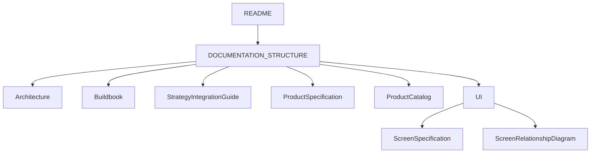
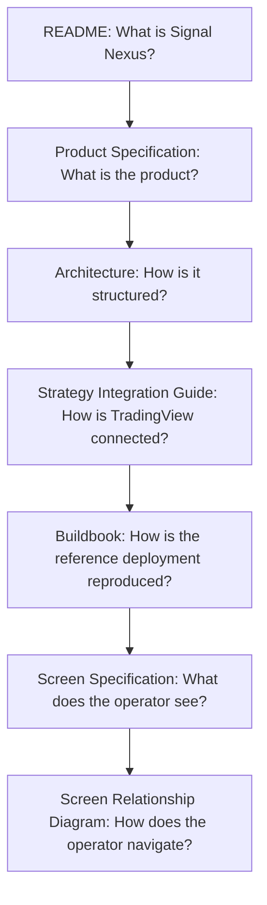

# Signal Nexus Documentation Structure

Before reading any document, start here.

This document defines the role and responsibility of every canonical document in the Signal Nexus documentation set.

Each document should focus only on its own responsibility and avoid repeating the responsibilities of other documents.

English is the canonical text. The Japanese edition is [DOCUMENTATION_STRUCTURE_JA.md](DOCUMENTATION_STRUCTURE_JA.md).

## Documents

| Document | Access | Purpose | Contains | Does not contain |
| --- | --- | --- | --- | --- |
| Architecture | Public | Canonical system layout | Components, data flow, public and private boundary | Install steps, screen fields, product lineup |
| Buildbook | Starter | Canonical build procedure | Accounts, the virtual machine, secrets, deploy, validation | Portal screens, strategy rules, research |
| Strategy Integration Guide | Public | Canonical TradingView connection | `strategy_id`, alert payload, webhook contract | Signal logic, indicator design, research |
| Screen Specification | Public | Canonical screen content | Purpose, what the user can learn, displayed information, navigation of each view | API design, database design, build steps |
| Screen Relationship Diagram | Public | Canonical screen navigation | The view tree and the jumps between views | Field lists, build steps |
| Product Specification | Public | Canonical product definition | What the operator gets, venues, lineup names | Install steps, screen label definitions, prices, which sales page to open |
| Product Catalog | Public | Comparison source | Lineup comparison, which problem each product answers | Prices, checkout, the GitHub Pages home, the product definition |
| index.md | Public | GitHub Pages home | Why Signal Nexus exists, the three problems, one workflow, the comparison section | Checkout, Buildbook steps, deployment commands |
| README | Public | Repository documentation for people who run the source | What Signal Nexus is, runtime modes, configuration, the webhook and strategy summary, build and start commands, the three validation checks | A sales page, a product catalog, checkout |
| LICENSE | Public | Community Edition license | Permissions, prohibitions, brand, reserved commercial rights | Trading-risk narrative, vulnerability-reporting steps |
| DISCLAIMER | Public | Offer terms for the Community Edition | Advice boundary, no asset management, no profit guarantee, warranty, liability, third parties | The copyright grant |
| RISK_DISCLOSURE | Public | Cryptocurrency and perpetual-market risks | Market, leverage, liquidity, liquidation, venue, contract, infrastructure, operation, regulation, how a stored result can differ | A guarantee of profit |
| SECURITY | Public | Vulnerability-reporting policy | How to report, scope, disclosure, response | A bug bounty |

Buildbook is the only canonical document that is not part of the public documentation set. Buildbook is included with Starter.

Buildbook is not required to deploy Signal Nexus. Buildbook exists for operators who need a complete, step-by-step guide to the reference deployment. README is the public entry point and the experienced-operator reference. Buildbook is that reference playbook. It does not establish that any other host can run the current deployment automation.

## Documentation availability

Public documentation:

- README
- Architecture
- Strategy Integration Guide
- Screen Specification
- Screen Relationship Diagram
- Product Specification
- Product Catalog
- LICENSE
- DISCLAIMER
- RISK_DISCLOSURE
- SECURITY

Starter documentation:

- Buildbook

Commercial packaging may evolve over time. The canonical definition of currently available products is maintained in [Product Specification](product/PRODUCT_SPECIFICATION.md).

## Access by product

This section records which materials a current product includes. It does not define the product.

Products are independent. Complete is the bundle of Starter and the Volume Pack and Profit Pack of the same date. It is not a higher edition of either pack. VenueAdd is the extension for one venue, including later maintenance of that same venue. It is not a right to every later venue, and it does not include the other products.

| Material | Starter | Volume Pack | Profit Pack | Complete | VenueAdd |
| --- | --- | --- | --- | --- | --- |
| Buildbook | ✅ | ❌ | ❌ | ✅ | ❌ |
| Research materials | ❌ | ✅ | ✅ | ✅ | ❌ |
| Venue-expansion materials | ❌ | ❌ | ❌ | ❌ | ✅ |

Complete includes Buildbook because Complete includes Starter. Volume Pack and Profit Pack include separate research materials. Complete includes both of the same date. VenueAdd includes the venue-expansion materials for that one venue, including later maintenance of the same venue.

## Product relationship

README is the public entry point. Public documentation does not require Starter. Buildbook is Starter material. The table above maps access for the current products. Product Specification is the canonical product definition.

## Common reading paths

I am evaluating Signal Nexus.

README → Product Specification → Architecture

I am choosing which product to read.

README → Product Catalog → Product Specification

I want to understand the platform.

README → Architecture → Product Specification

I want to operate multiple venues.

README → Architecture → Screen Specification

I want to understand the user experience.

README → Screen Relationship Diagram → Screen Specification

I want to deploy Signal Nexus.

Start with README.

README is the public entry point for an experienced operator. It includes the deployment entry and the validation flow.

If README is sufficient for your environment and experience level, no additional documentation is required.

If you need a complete end-to-end deployment guide, including:

- account creation
- cloud setup
- networking
- security configuration
- secrets management
- backup configuration
- deployment validation
- operational guidance

then Starter is required.

→ Buildbook

I want to connect TradingView.

README → Strategy Integration Guide

## Relationship



```text
README
  |
  v
DOCUMENTATION_STRUCTURE
  |
  +-- Architecture
  +-- Buildbook
  +-- Strategy Integration Guide
  +-- Product Specification
  +-- Product Catalog
  +-- UI
        +-- Screen Specification
        +-- Screen Relationship Diagram
```

## Documentation responsibility flow

README answers what Signal Nexus is.

Product Specification answers what the product is.

Product Catalog answers which product to read, and which regional sales page to open. It does not set a price and it does not take payment.

Architecture answers how it is structured.

Strategy Integration Guide answers how TradingView is connected.

README is the public entry point and the experienced-operator reference. Buildbook answers how the reference deployment is reproduced from an empty start. Access to Buildbook is Starter. Complete is the bundle that includes Starter.

Screen Specification answers what the operator sees.

Screen Relationship Diagram answers how the operator navigates.



