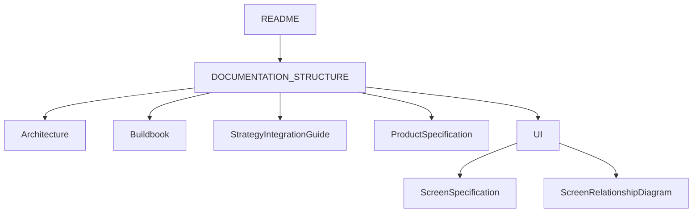
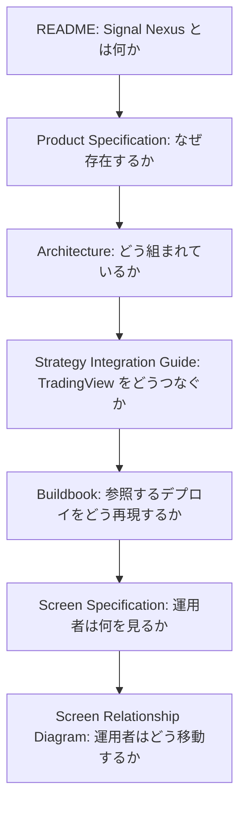

# Signal Nexus ドキュメント体系

他の文書を読む前に、この文書から始めてください。

この文書は Signal Nexus ドキュメント体系の責務を定義する正本です。

各文書は自分の責務だけに集中し、他文書の責務説明を繰り返しません。

原文は英語版 [DOCUMENTATION_STRUCTURE.md](DOCUMENTATION_STRUCTURE.md) です。

## 文書

| 文書 | アクセス | 役割 | 含むもの | 含まないもの |
| --- | --- | --- | --- | --- |
| Architecture | Public | システム構成の正本 | 部品、データの流れ、公開と非公開の境界 | 導入手順、画面の項目、製品の名前一覧 |
| Buildbook | Starter / Membership | 構築手順の正本 | アカウント、仮想マシン、secret、デプロイ、確認 | ポータルの画面、戦略のルール、リサーチ |
| Strategy Integration Guide | Public | TradingView 接続の正本 | `strategy_id`、アラートの本文、Webhook の契約 | シグナルのロジック、インジケーターの設計、リサーチ |
| Screen Specification | Public | 画面仕様の正本 | 目的、分かること、表示するもの、各画面からの移動 | API 設計、データベース設計、構築手順 |
| Screen Relationship Diagram | Public | 画面遷移の正本 | 画面のツリーと、画面から画面への移動 | 項目の一覧、構築手順 |
| Product Specification | Public | 製品説明の正本 | 利用者が得るもの、対応する取引所、製品名 | 導入手順、画面の表示名の定義、価格 |
| README | Public | 公開の入口と、経験のある運用者向けの参照 | Signal Nexus が何か、実行モード、設定、Webhook と戦略の要約、Build と Start、三つの確認 | このファイルの表、導入の教科書、画面仕様 |
| LICENSE | Public | Community Edition のライセンス | 許可、禁止、ブランド、留保された商用の権利 | 取引リスクの叙述、脆弱性の報告手順 |
| DISCLAIMER | Public | Community Edition を提供する条件 | 助言との境界、資産運用をしないこと、利益を保証しないこと、保証、責任、第三者 | 著作権の許諾 |
| RISK_DISCLOSURE | Public | 暗号資産と無期限市場のリスク | 相場、レバレッジ、流動性、清算、会場、契約、基盤、運用、規制、保存された結果が後日と異なりうること | 利益の保証 |
| SECURITY | Public | 脆弱性の報告方針 | 報告方法、範囲、開示、対応 | 報奨金 |

Buildbook は、公開文書のセットに入らない唯一の正本です。Starter と、すべての Membership から読めます。

Buildbook は Signal Nexus の利用に必須ではありません。Buildbook は、参照するデプロイを手順どおり作りたい利用者向けの完全ガイドです。README は、公開の入口であり、経験のある運用者向けの参照です。Buildbook は、その参照実装の手順書です。いまのデプロイ自動化が、どのホストでも動くとは定めません。

## 文書の入手

公開文書:

- README
- Architecture
- Strategy Integration Guide
- Screen Specification
- Screen Relationship Diagram
- Product Specification
- LICENSE
- DISCLAIMER
- RISK_DISCLOSURE
- SECURITY

Starter の文書:

- Buildbook

Membership の文書:

- Alpha Membership には、Buildbook と、取引所を広げる資料が付きます。
- Beta Membership には、Alpha Membership のすべてに加え、リサーチを広げる資料が付きます。

## 区分ごとの入手

Alpha Membership は Starter を含みます。Beta Membership は Alpha Membership を含みます。

| 資料 | Starter | Alpha Membership | Beta Membership |
| --- | --- | --- | --- |
| Buildbook | ✅ | ✅ | ✅ |
| リサーチ資料 | ❌ | ❌ | ✅ |
| 取引所を広げる資料 | ❌ | ✅ | ✅ |

リサーチ資料は、リサーチの公開物、検証の報告、戦略の更新です。取引所を広げる資料は、取引所の接続と、その取引所の導入資料です。

## 商品との関係

文書は、入手の区分ごとに分かれます。

### Free

公開文書と、ソースを公開している Community Edition です。

含むもの:

- README
- Architecture
- Strategy Integration Guide
- Screen Specification
- Screen Relationship Diagram
- Product Specification
- LICENSE
- DISCLAIMER
- RISK_DISCLOSURE
- SECURITY

### Starter

Buildbook を読めます。

含むもの:

- Buildbook

### Alpha Membership

Starter のすべてに加え、取引所を広げる資料です。

含むもの:

- Buildbook
- 取引所の接続
- 取引所の導入資料
- Membership 向けの追加資料

### Beta Membership

Alpha Membership のすべてに加え、リサーチを広げる資料です。

含むもの:

- Buildbook
- 取引所の接続
- 取引所の導入資料
- リサーチの公開物
- 検証の報告
- 戦略の更新
- Membership 向けの追加資料

## 読み方

Signal Nexus を検討している。

README → Product Specification → Architecture

プラットフォームを理解したい。

README → Architecture → Product Specification

複数の取引所を運用したい。

README → Architecture → Screen Specification

画面の動きを理解したい。

README → Screen Relationship Diagram → Screen Specification

Signal Nexus をデプロイしたい。

まず README を参照してください。

README は、経験のある運用者向けの公開の入口です。デプロイの入口と確認の流れを含みます。

既に必要なサービスや環境構築に慣れている場合は、README だけで十分な場合があります。

ただし、

- アカウント作成
- クラウド構築
- ネットワーク設定
- セキュリティ設定
- シークレット管理
- バックアップ設定
- 動作確認
- 運用上の注意

まで含めた完全な手順が必要な場合は、Starter または Membership が必要です。

→ Buildbook

TradingView とつなぎたい。

README → Strategy Integration Guide

## 関係



```text
README
  |
  v
DOCUMENTATION_STRUCTURE
  |
  +-- Architecture
  +-- Buildbook
  +-- Strategy Integration Guide
  +-- Product Specification
  +-- UI
        +-- Screen Specification
        +-- Screen Relationship Diagram
```

## 責務の流れ

README は、Signal Nexus が何かを答えます。

Product Specification は、なぜ存在するかを答えます。

Architecture は、どう組まれているかを答えます。

Strategy Integration Guide は、TradingView をどうつなぐかを答えます。

README は、公開の入口であり、経験のある運用者向けの参照です。Buildbook は、参照するデプロイを何も無い状態から再現する手順を答えます。Buildbook を読むには、Starter または Membership が必要です。

Screen Specification は、運用者が何を見るかを答えます。

Screen Relationship Diagram は、運用者がどう移動するかを答えます。



