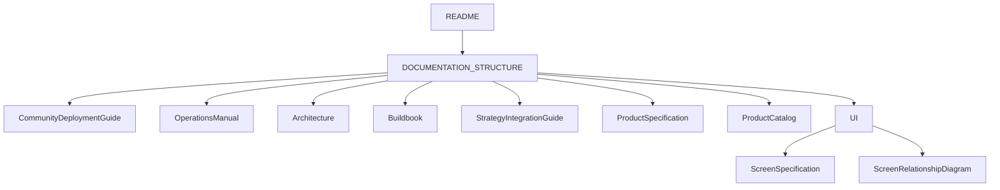
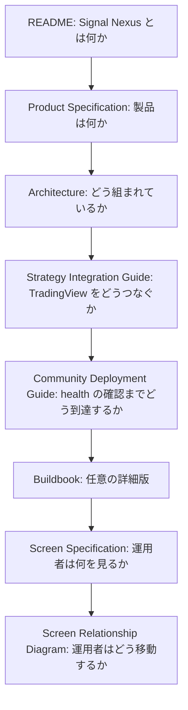

# Signal Nexus ドキュメント体系

他の文書を読む前に、この文書から始めてください。

この文書は Signal Nexus ドキュメント体系の責務を定義する正本です。

各文書は自分の責務だけに集中し、他文書の責務説明を繰り返しません。

原文は英語版 [DOCUMENTATION_STRUCTURE.md](DOCUMENTATION_STRUCTURE.md) です。

## 文書

| 文書 | アクセス | 役割 | 含むもの | 含まないもの |
| --- | --- | --- | --- | --- |
| Architecture | Public | システム構成の正本 | 部品、データの流れ、公開と非公開の境界 | 導入手順、画面の項目、製品の名前一覧 |
| Community Deployment Guide | Public | デプロイの正本 | 呼び出し元リポジトリ、runtime 七ファイル、secret、variable、health の確認 | コンソールの画面、顧客の registry、FAQ |
| Operations Manual | Public | 十三章のバインダー | 章の表と読む順 | 導入のクリック、顧客の registry |
| Customer Lifecycle | Public | 1つの環境 | 呼び出し元リポジトリ 1つ、pin 1つ、推奨 SHA 1つ、購入まで空の manifest | ホストのクリック、secret の値 |
| Customer Creation | Public | 呼び出し元の立ち上げ | template、runtime 7ファイル、`confirm`、`venues: []` | 9つの secret の値、`workflow_dispatch` |
| Infrastructure Execution | Public | ホストと Render | Linux ホスト、PostgreSQL 16、Render Web Service、9つの secret、5つの variable | `workflow_dispatch` |
| Deployment Readiness | Public | 最初とあとの dispatch | チェックリスト、health、SHA256 7つ | コンソールの画面 |
| Launch Gate | Public | 固定した開始状態 | 記録した pin、ハッシュ、ホストと Render アカウントの阻止 | 作済みの VM |
| Release Management | Public | 公開 tag と pin の移動 | リリースの条件、書き出し、推奨 SHA | 顧客のホスト |
| Venue License | Public | 有料会場のアクセス | manifest、Read、`VENUEADD_READ_TOKEN` | 最初の health に必須の導入 |
| AddVenue Operations | Public | 最初の成功のあとの 1 行 | 作業例、返金 | txflow の導入 |
| Troubleshooting | Public | ガイド経路の失敗 | `none` での futures read、pin の不一致、再起動しない取得 | コンソールの復旧 |
| Rollback | Public | その呼び出し元だけ | 最初の deploy の失敗、あとの deploy の失敗 | 別の呼び出し元 |
| Buildbook | Starter | Community Deployment Guide の詳細版 | コンソールのクリック、チェックリスト、画面例、FAQ、失敗を避けるメモ | ガイドが述べない必須の事実 |
| Strategy Integration Guide | Public | TradingView 接続の正本 | `strategy_id`、アラートの本文、Webhook の契約 | シグナルのロジック、インジケーターの設計、リサーチ |
| Screen Specification | Public | 画面仕様の正本 | 目的、分かること、表示するもの、各画面からの移動 | API 設計、データベース設計、構築手順 |
| Screen Relationship Diagram | Public | 画面遷移の正本 | 画面のツリーと、画面から画面への移動 | 項目の一覧、構築手順 |
| Product Specification | Public | 製品定義の正本 | 利用者が得るもの、対応する取引所、製品名 | 導入手順、画面の表示名の定義、価格、どの販売ページを開くか |
| Product Catalog | Public | 比較の正本 | 商品の比較、どの課題にどの商品が対応するか | 価格、Checkout、GitHub Pages の Home、製品の定義 |
| index.md | Public | GitHub Pages の Home | Signal Nexus がなぜ存在するか、三つの課題、一つの運用、比較の節 | Checkout、Buildbook の手順、デプロイ命令 |
| starter/index.html | Public | Starter の商品ページ | Starter が何か、公開済みの価格、Stripe Checkout | ラインナップ比較、Buildbook の手順 |
| volume-pack/index.html | Public | Volume Pack の商品ページ | その購入日に含まれるもの、公開済みの価格、Stripe Checkout | ラインナップ比較、戦略のソース |
| profit-pack/index.html | Public | Profit Pack の商品ページ | その購入日に含まれるもの、公開済みの価格、Stripe Checkout | ラインナップ比較、戦略のソース |
| complete/index.html | Public | Complete の商品ページ | 一つの日付の束、公開済みの価格、Stripe Checkout | ラインナップ比較、Complete のリポジトリ |
| README | Public | ソースを動かす人向けのリポジトリ文書 | Signal Nexus が何か、実行モード、設定、Webhook と戦略の要約、Build と Start、三つの確認 | 販売ページ、商品目録、Checkout |
| LICENSE | Public | Community Edition のライセンス | 許可、禁止、ブランド、留保された商用の権利 | 取引リスクの叙述、脆弱性の報告手順 |
| DISCLAIMER | Public | Community Edition を提供する条件 | 助言との境界、資産運用をしないこと、利益を保証しないこと、保証、責任、第三者 | 著作権の許諾 |
| RISK_DISCLOSURE | Public | 暗号資産と無期限市場のリスク | 相場、レバレッジ、流動性、清算、会場、契約、基盤、運用、規制、保存された結果が後日と異なりうること | 利益の保証 |
| SECURITY | Public | 脆弱性の報告方針 | 報告方法、範囲、開示、対応 | 報奨金 |

Community Deployment Guide が、デプロイの公開の正本です。Operations Manual は十三章のバインダーです。第 03、04、05、07、09 章はガイドを展開します。ガイドの代わりにはなりません。Buildbook は、公開文書のセットに入らない唯一の正本です。Buildbook は Starter に含まれます。

Buildbook は Signal Nexus の利用に必須ではありません。Community Deployment Guide の詳細版です。README は最初に読む文書です。ガイドが、health の確認までの手順です。第 13 章は `business/consideration/design/` に残り、書き出しません。

## 文書の入手

公開文書:

- README
- Community Deployment Guide
- Operations Manual
- Customer Lifecycle
- Customer Creation
- Infrastructure Execution
- Deployment Readiness
- Launch Gate
- Release Management
- Venue License
- AddVenue Operations
- Troubleshooting
- Rollback
- Architecture
- Strategy Integration Guide
- Screen Specification
- Screen Relationship Diagram
- Product Specification
- Product Catalog
- Starter の商品ページ
- Volume Pack の商品ページ
- Profit Pack の商品ページ
- Complete の商品ページ
- LICENSE
- DISCLAIMER
- RISK_DISCLOSURE
- SECURITY

Starter の文書:

- Buildbook

商品のまとめ方は、時期とともに変わり得ます。いま提供している商品の定義の正本は [Product Specification](product/PRODUCT_SPECIFICATION.md) です。

## 商品ごとの入手

この節は、いまの商品がどの資料を含むかを記録します。商品の定義は書きません。

商品は独立しています。Complete は、Starter と、同じ日付の Volume Pack と Profit Pack の束です。どちらのパックの上位版でもありません。VenueAdd は、一つの会場の拡張です。その会場の後の保守を含みます。あとから増えるすべての会場の権利ではなく、他の商品も含みません。

| 資料 | Starter | Volume Pack | Profit Pack | Complete | VenueAdd |
| --- | --- | --- | --- | --- | --- |
| Buildbook | ✅ | ❌ | ❌ | ✅ | ❌ |
| リサーチ資料 | ❌ | ✅ | ✅ | ✅ | ❌ |
| 取引所を広げる資料 | ❌ | ❌ | ❌ | ❌ | ✅ |

Complete の Buildbook は、Complete が Starter を含むためです。Volume Pack と Profit Pack は、別のリサーチ資料を含みます。Complete は、同じ日付の両方を含みます。VenueAdd は、その一つの会場を広げる資料と、その会場の後の保守を含みます。

## 商品との関係

README は、最初に読む文書です。公開文書に、Starter は要りません。Buildbook は Starter の資料です。上の表は、いまの商品の入手を対応づけます。Product Specification が、製品定義の正本です。

## 読み方

Signal Nexus を検討している。

README → Product Specification → Architecture

どの商品を読むか選ぶ。

README → Product Catalog → Product Specification

プラットフォームを理解したい。

README → Architecture → Product Specification

複数の取引所を運用したい。

README → Architecture → Screen Specification

画面の動きを理解したい。

README → Screen Relationship Diagram → Screen Specification

Signal Nexus をデプロイしたい。

README → Community Deployment Guide

ガイドが、health の確認までの公開の手順です。Architecture は、システム構成を確認するための文書です。Operations Manual が十三章を示します。第 02 章から第 09 章は、あとの手順を展開します。ガイドの代わりにはなりません。

Buildbook は任意です。チェックリスト、画面例、FAQ、失敗を避けるメモを加えます。ガイドに無い必須事項は加えません。

→ Buildbook

TradingView とつなぎたい。

README → Strategy Integration Guide

## 関係



```text
README
  |
  v
COMMUNITY_DEPLOYMENT_GUIDE
  |
  +-- Architecture
  +-- Buildbook, optional
```

## 責務の流れ

README は、Signal Nexus が何かを答えます。

Product Specification は、製品が何かを答えます。

Product Catalog は、どの商品を読むか、どの商品ページを開くかを答えます。価格は定めず、決済も受けません。商品ページが、公開済みの価格を書き、Stripe Checkout を開きます。Home は決済を受けません。

Architecture は、どう組まれているかを答えます。

Strategy Integration Guide は、TradingView をどうつなぐかを答えます。

README は最初に読む文書です。Community Deployment Guide は、health の確認までどう進むかを答えます。Buildbook は任意の詳細版です。Buildbook を読むには Starter が必要です。Complete は、Starter を含む束です。

Screen Specification は、運用者が何を見るかを答えます。

Screen Relationship Diagram は、運用者がどう移動するかを答えます。



