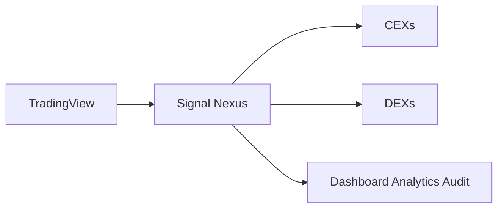
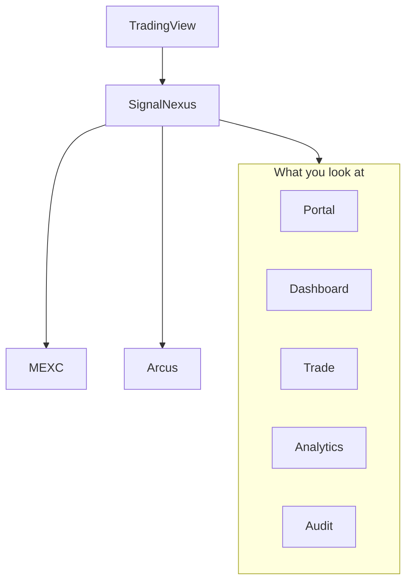
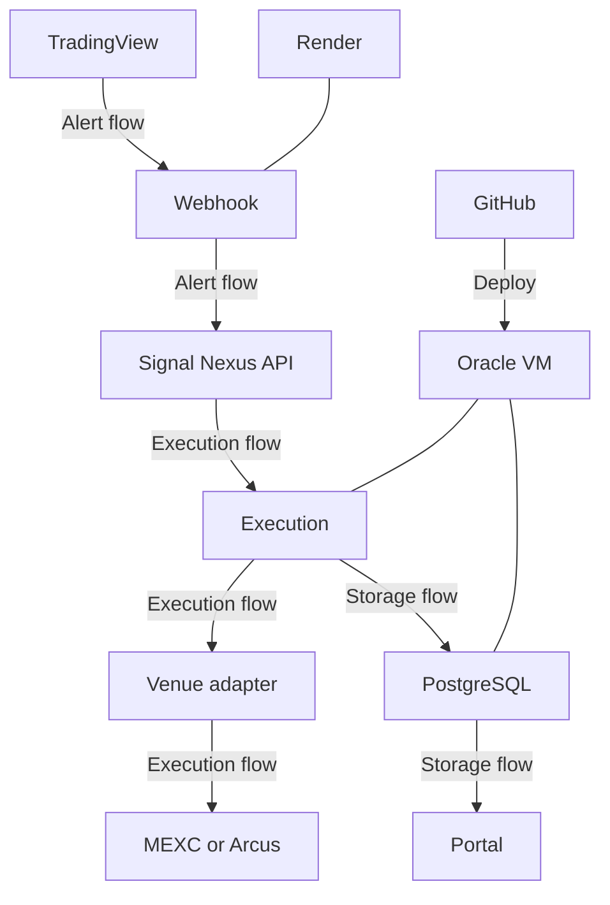
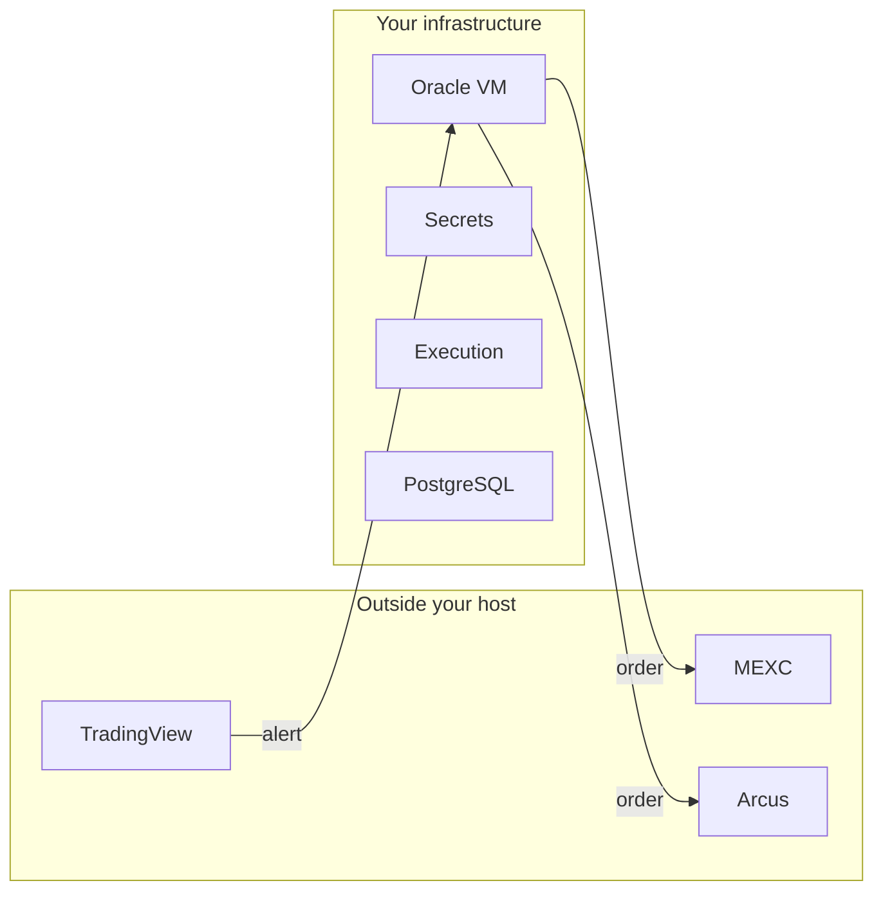
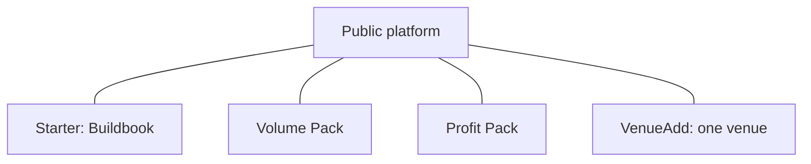

# Signal Nexus Architecture

For documentation structure and responsibilities, see [../DOCUMENTATION_STRUCTURE.md](../DOCUMENTATION_STRUCTURE.md).

This document is the canonical reference for system architecture. The Japanese edition is [ARCHITECTURE_JA.md](ARCHITECTURE_JA.md).

## Overview

Signal Nexus is a self-hosted platform, a multi-venue trading operations platform, and a research-to-execution path.

You operate more than one venue through one workflow. You can bring your own research, or use a research package. Your funds stay at the venue. Your keys stay on infrastructure you run.

The figures below are that story, in order. They are not an install procedure.

### 0. Signal Nexus in 30 seconds

Create signals in TradingView. Signal Nexus runs them across more than one venue. You watch that activity from one operational view.

MEXC Spot and MEXC Futures are the CEX paths now. Arcus is the DEX path now.

### 1. Signal Nexus at a glance

MEXC Spot, MEXC Futures, and Arcus are the current order paths. A venue outside that public release is not an order path in this layout. Portal, Dashboard, Trade, Analytics, and Audit are views of your own operation. They do not place an order.

### 2. System components

Alert flow is TradingView to the webhook on Render. Execution flow, when `EXECUTION_MODE` is `live`, continues on the Oracle VM to the venue. In `dry_run` the order stops before the venue. Storage flow keeps the result in PostgreSQL on that VM. The portal reads it.

### 3. Public and private boundary

Your funds stay at the venue. Your keys stay in Secrets on infrastructure you run. Signal Nexus does not hold either. That is: your funds, your keys, your infrastructure.

### 4. How the same workflow extends

These attach to the same workflow. They are not a ladder.

Starter is Buildbook access. That playbook reproduces the reference deployment from an empty start. The public README remains enough when you already know the services.

Volume Pack and Profit Pack are separate research packages. Research stays private. Complete is the bundle of Starter and both packages of the same date. It is not a higher edition of either package, and it does not include VenueAdd.

VenueAdd connects one venue that is not in the public release, after that venue is enabled and documented. Maintenance of that venue stays in the same extension. It is not a dated research package, and it is not a right to every later venue.

What each product includes is defined in [Product Specification](../product/PRODUCT_SPECIFICATION.md). This section does not set a price.

## How the parts separate

Signal Nexus separates research, execution, operations, and infrastructure.

You can bring your own research, or use a research package. One workflow reaches more than one venue. You host the execution and the records.

## Components

### TradingView

TradingView sends an HTTP POST to the Render webhook URL. The body is JSON. The secret travels in that body. TradingView does not set an authentication header.

### Render

Render runs the webhook process (`app.main`). It accepts `POST /webhook` and answers `GET /health`. With `EXECUTION_MODE` unset, the webhook keeps the record path and does not send an order. That mode is `dry_run`. `live` sends orders. Render does not open Postgres.

### Analytics API

The Analytics API runs on the virtual machine and listens for the operation record and, when orders are sent, the order handoff. Its own `GET /health` only shows that the process answered.

### Postgres

Postgres runs on the same virtual machine as the Analytics API. It listens on that machine, not on the public internet. The audit record is stored there. A Discord delivery does not replace that row.

### Oracle VM

The virtual machine is the host for the Analytics API, Postgres, and the order path to MEXC and Arcus. The Buildbook uses Oracle Cloud, running Ubuntu, as the reference environment for that machine. Render is a separate host.

### GitHub Actions

The workflow `analytics-vm` runs on a push to the deploying repository. Before it logs in, it checks Render health and the SSH host key fingerprint. It then copies the repository and writes secret files on the VM.

The job runs only when `github.repository` equals the repository name written in the workflow file. The name shipped in the public source is an example. A deployment replaces that example with its own `account/repo`. The comparison is what stops the workflow from deploying a different repository.

### Discord

Discord receives an audit notification when `DISCORD_WEBHOOK_URL` is set on Render. Discord is a delivery destination. The system of record is Postgres.

### MEXC

MEXC Spot and MEXC Futures are current order paths. Read keys and order keys are different, and spot keys are different from futures keys. The order keys are on the virtual machine.

### Arcus

Arcus is a current order path. Fills are read with `ANALYTICS_ARCUS_ADDRESS` and are not signed. Orders use `ARCUS_ADDRESS` and `ARCUS_SIGNING_KEY`. Those are two settings. They are not required to be two different addresses. One wallet can be stored in both names. The signing key is required only for orders.

## Data flow

1. TradingView posts the alert to Render.
2. Render checks `WEBHOOK_SECRET`, then `strategy_id`, `symbol`, and `action` against `config/strategies.yml`.
3. The order amount is `size_quote` on that row. The alert body does not carry `size` or `size_quote`.
4. In `dry_run`, Render does not send the order.
5. In `live`, the order goes out through the Analytics API on the virtual machine to MEXC or Arcus.
6. The audit row is stored in Postgres. Render can deliver a copy to Discord.

A protective exit is an added function that covers sharp price changes between bars, because a TradingView alert is evaluated only when a bar closes. Signal Nexus keeps one stop price and one take-profit price for each strategy. Those prices are set by applying `loss_pct` and `profit_pct` to that strategy's latest entry fill. Every five seconds, the virtual machine reads a fresh public price and closes that strategy's entire remaining quantity with a market order at the first level the price crosses. It does not replace the alert. It limits an unexpected loss, or secures a profit, until the next bar's alert arrives. The prices are not stored per fill, and they are not taken from average cost. It is not a stop or take-profit order at MEXC or Arcus. The exit writes one of the existing audit events and forwards that copy to Render, which delivers Discord. The Dashboard latest-alert time reads `SIGNAL RECEIVED` only, so this exit does not move it. A failed forward leaves the audit row in Postgres.

`GET /health` on Render and `GET /health` on the Analytics API each prove only that the process answered.

## Public vs private boundary

Platform is public. The public repository contains the webhook, execution, analytics, portal, and the deploy workflow a deployment runs itself.

Research is private. How a strategy was found, ranked, or left unpublished is not part of this layout and is not in the public repository.
