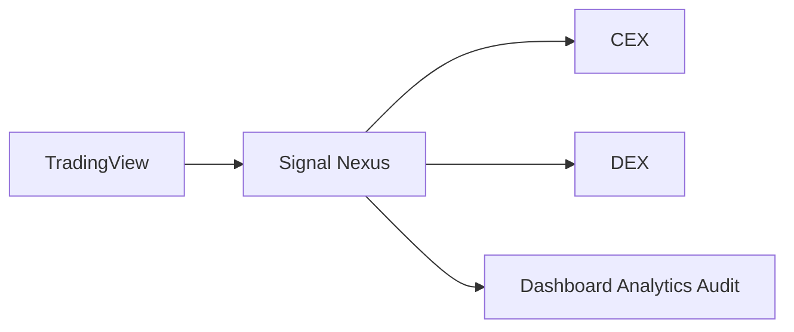
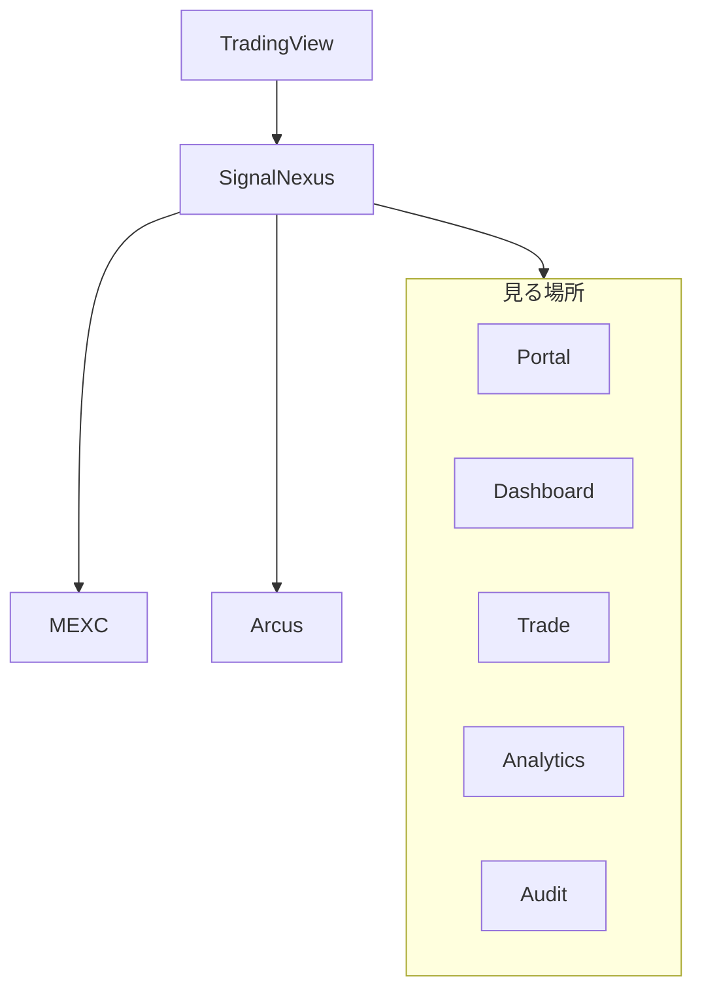
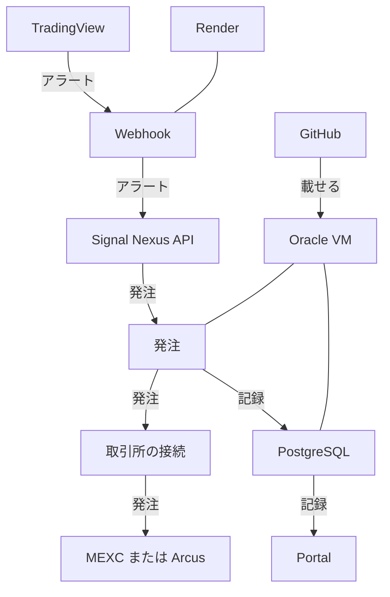
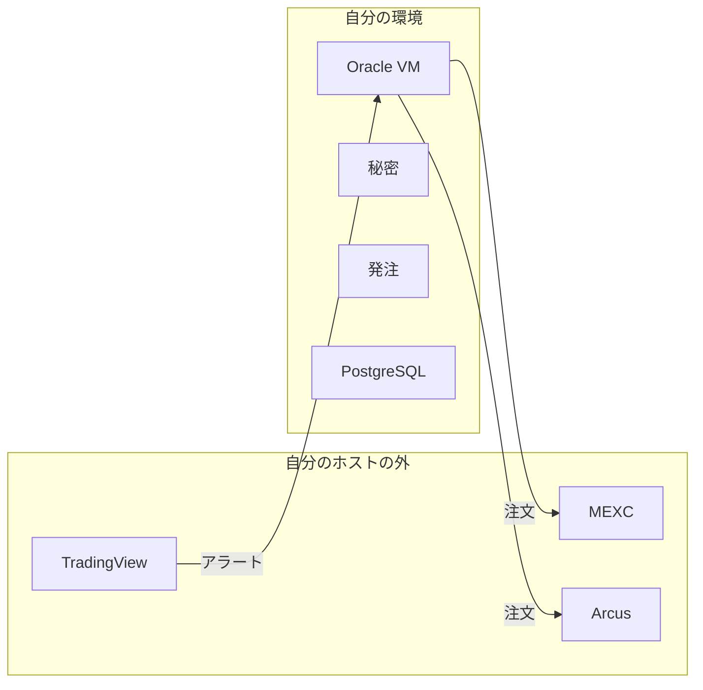
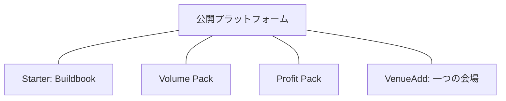

# Signal Nexus の構成

文書の役割は [../DOCUMENTATION_STRUCTURE_JA.md](../DOCUMENTATION_STRUCTURE_JA.md) にあります。

この文書は、システム構成の正本です。英語版 [ARCHITECTURE.md](ARCHITECTURE.md) が原文です。

## 概要

Signal Nexus は、自分でホストするプラットフォームです。複数の取引所を、一つの運用で扱います。リサーチから発注までを、一つの流れにします。

複数の取引所を、一つのワークフローで運用します。自分のリサーチを持ち込むことも、リサーチのパッケージを使うこともできます。資金は取引所に残ります。鍵は、自分で動かしている環境に残ります。

下の図は、その順で読む物語です。導入手順ではありません。

### 0. 30秒で見る

シグナルは TradingView で作ります。Signal Nexus が、複数の取引所へ実行します。その動きは、一つの運用画面から見ます。

いまの CEX は、MEXC 現物と MEXC 先物です。いまの DEX は Arcus です。

### 1. ひと目で見る

現在の発注先は、MEXC 現物、MEXC 先物、Arcus です。公開版に無い会場は、この構成の発注先ではありません。Portal、Dashboard、Trade、Analytics、Audit は、自分の運用を見る場所です。そこから注文は出せません。

### 2. 部品と流れ

アラートは TradingView から Render の Webhook へ進みます。`EXECUTION_MODE` が `live` のとき、発注は Oracle の VM から取引所へ続きます。`dry_run` では、取引所の前で止まります。記録は、その VM の PostgreSQL に残ります。Portal はそれを読みます。

### 3. 外と、自分の環境

資金は取引所に残ります。鍵は、自分で動かしている環境の秘密に残ります。Signal Nexus は、どちらも預かりません。Your funds, your keys, your infrastructure です。

### 4. 同じワークフローの広がり

これらは、同じワークフローに付きます。階段ではありません。

Starter は Buildbook です。その手順書は、参照するデプロイを何も無い状態から再現します。必要なサービスに慣れていれば、公開の README で足ります。

Volume Pack と Profit Pack は、別々のリサーチのパッケージです。リサーチは非公開です。Complete は、Starter と、同じ日付の両方のパッケージの束です。どちらのパッケージの上位版でもなく、VenueAdd も含みません。

VenueAdd は、公開版に無い一つの会場を、その会場が有効になり手順が文書になったあとで接続します。その会場の保守は、同じ拡張に残ります。日付のリサーチのパッケージではなく、あとから増えるすべての会場の権利でもありません。

一つの戦略は、複数の会場を名指しできます。一つのアラートは、そのアクションを受け付ける有効な deployment のすべてへ進みます。追加会場も同じ経路です。

Webhook は会場の実装を知りません。扱うのは `venue_id` だけです。会場ごとの差異、SDK、API クライアント、署名方式、秘密、Venue Package は VM だけが持ちます。新しい VenueAdd を追加しても、Webhook に会場固有コードを追加しません。

`ANALYTICS_API_URL` があるとき、`execute_order` は Venue Package を import する前に転送します。組み込みの集合は、既存の `RESERVED_VENUE_IDS` です。値は `arcus`、`mexc_spot`、`mexc_futures` です。別の定数は増やしません。`arcus` は `/api/arcus/order`、`mexc_spot` と `mexc_futures` は `/api/mexc/order` です。この集合に無い `venue_id` は、すべて同じ転送規則で `/api/venue/order` へ渡します。Webhook はそれらの ID を区別しません。新しい VenueAdd を足しても、転送規則は変わらず、Webhook の改修も要りません。TxFlow、Lighter、QFEX は例であり、例外ではありません。VenueAdd はすべて同じ経路を通ります。会場ごとの Webhook 分岐は追加しません。`ANALYTICS_API_URL` が無いとき、未ロードの会場はこれまでどおり `venue has no order adapter` で止まります。

`SIGNAL_NEXUS_VENUEADD` を import し、`execute`、`mark`、`sync_lots`、`open_orders`、`balance`、`apply_leverage` の六つを呼ぶのは、VM のプロセスです。設定が空なら、MEXC 現物、MEXC 先物、Arcus は今のままです。パッケージが予約 ID、重複した ID、または 1 以外のポート版を返すと、そのプロセスは起動時に止まります。有料会場の接続は、このツリーの外に残します。

この引き渡しの完了は、Webhook が転送し、Analytics API が受信の監査を保存したときです。取引所の約定は、この引き渡しの出口ではありません。確認の前に、Webhook、`signal-nexus-dev`、Analytics VM の `strategies.yml` のコミットが同じであることを見ます。世代が違う状態は、確認になりません。

各商品が何を含むかは [Product Specification](../product/PRODUCT_SPECIFICATION_JA.md) が定義します。この節は価格を定めません。

## 分かれているもの

Signal Nexus は、リサーチ、発注、運用、インフラを分けています。

自分のリサーチを持ち込むことも、リサーチのパッケージを使うこともできます。一つのワークフローが、複数の取引所に届きます。発注と記録は、自分でホストします。

## 部品

### TradingView

TradingView は、Render の Webhook URL へ HTTP POST を送ります。本文は JSON です。秘密はその本文に入ります。TradingView は認証ヘッダを付けません。

### Render

Render は Webhook のプロセス（`app.main`）を動かします。`POST /webhook` を受け、`GET /health` に応答します。`EXECUTION_MODE` が未設定のときは、記録の経路は残り、注文は出ません。この状態が `dry_run` です。`live` で注文を出します。Render は Postgres を開きません。

### Analytics API

Analytics API は仮想マシン上で動きます。運用の記録と、注文を出すときの引き渡しを受けます。自身の `GET /health` が示すのは、プロセスが応答したことだけです。

### Postgres

Postgres は、Analytics API と同じ仮想マシンで動きます。待ち受けるのはそのマシンの中で、公開インターネットには出しません。監査の行はここに保存します。Discord への配達は、この行の代わりにはなりません。

### Oracle の VM

仮想マシンは、Analytics API、Postgres、そして MEXC と Arcus への発注を置く場所です。この一連の文書でそのマシンの参照環境にしているのは、Ubuntu を動かす Oracle Cloud です。Render は別のホストです。

### GitHub Actions

ワークフロー `analytics-vm` は、デプロイするリポジトリへの push で動きます。ログインの前に、Render の health と SSH ホスト鍵のフィンガープリントを確認します。そのあと、リポジトリをコピーし、secret のファイルを VM に書きます。

ジョブが動くのは、`github.repository` がワークフローに書いたリポジトリ名と一致するときだけです。公開ソースに入っている名前は例です。自分のデプロイでは、その例を自分の `account/repo` に置き換えます。この比較があるので、ワークフローは別のリポジトリを載せません。

### Discord

Render に `DISCORD_WEBHOOK_URL` があるとき、Discord は監査の通知を受け取ります。Discord は届け先です。記録の正本は Postgres です。

### MEXC

MEXC 現物と MEXC 先物は、いまの発注先です。読み取りキーと発注キーは別で、現物と先物も別です。発注キーは仮想マシンにあります。

### Arcus

Arcus は、いまの発注先です。約定の読み取りは `ANALYTICS_ARCUS_ADDRESS` で、署名しません。注文は `ARCUS_ADDRESS` と `ARCUS_SIGNING_KEY` です。設定は二つです。アドレスが別である必要はありません。一つのウォレットを両方の名前に入れてかまいません。署名鍵が要るのは注文だけです。

## データの流れ

1. TradingView がアラートを Render に送る。
2. Render が `WEBHOOK_SECRET` を確認し、`strategy_id`、`symbol`、`action` を `config/strategies.yml` と照合する。
3. 注文額は、その行の `size_quote` である。アラートの本文に `size` も `size_quote` も無い。
4. `dry_run` では、Render は注文を出さない。
5. `live` では、Webhook が会場名を Analytics API へ転送する。組み込み会場は既存の注文エンドポイントを使う。それ以外の会場名は `POST /api/venue/order` を使う。注文を実行するのは仮想マシンである。
6. 監査の行は Postgres に保存される。Render は写しを Discord へ届けられる。

保護決済は、TradingView のアラートが足の確定時にだけ評価されるため、その間の急な価格変化への対応を補うための付加機能です。Signal Nexus は、戦略ごとにストップ 価格1 つと利食い価格 1 つを持ちます。価格は、その戦略の最新エントリー約定に loss_pct と profit_pct を掛けて決めます。仮想マシンが 5 秒ごとに新しい公開価格を見て、先に割れた方で、その戦略の残数量全体を成行で閉じます。アラートの代わりではなく、次の足のアラートが来るまでに想定外の損失を防ぐ、もしくは利益の確保を行うための保護です。約定ごとには保存せず、平均建値からも取りません。MEXC や Arcus のストップ注文でも利食い注文でもありません。決済は既存の監査種別を 1 つ書き、その写しを Render へ渡します。Discord の送信は Render が行います。Dashboard の最新アラート時刻は `SIGNAL RECEIVED` だけを読むため、この決済では動きません。転送に失敗しても、監査行は Postgres に残ります。

Render の `GET /health` と Analytics API の `GET /health` は、それぞれ、そのプロセスが応答したことだけを示す。

## 公開と非公開の境界

Platform is Public. 公開リポジトリにあるのは、Webhook、発注、Analytics、ポータル、そして自分で動かすデプロイのワークフローです。

Research is Private. 戦略をどう見つけ、どう順位を付け、なぜ公開しなかったかは、この構成には含まれません。公開リポジトリにもありません。
