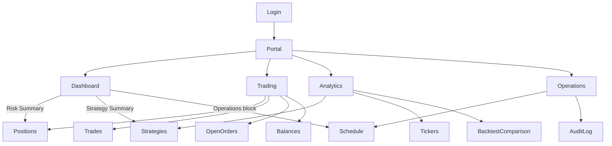

# Screen Relationship Diagram

For documentation structure and responsibilities, see [../DOCUMENTATION_STRUCTURE.md](../DOCUMENTATION_STRUCTURE.md).

This document is the canonical screen navigation diagram. The Japanese edition is [SCREEN_RELATIONSHIP_DIAGRAM_JA.md](SCREEN_RELATIONSHIP_DIAGRAM_JA.md).

No screen places an order. Performance is the Dashboard reading of the run. It is not a separate destination. Backtest Comparison is a page inside Analytics.

Login is the gate in front of Portal. It is not a fifth primary view.

## Tree

```text
Login
  |
  v
Portal
├─ Dashboard
├─ Trading
│   ├─ Positions
│   ├─ Trades
│   ├─ Open Orders
│   └─ Balances
├─ Analytics
│   ├─ Strategies
│   ├─ Tickers
│   └─ Backtest Comparison
└─ Operations
    ├─ Schedule
    └─ Audit Log
```

The four names under Portal are always available. The names nested under Trading, Analytics, and Operations are switches inside that view. Opening one does not leave the view.

## Jumps

These are the links a screen draws to another view. The switch inside a view is not listed again.

- Dashboard opens Trading at Positions, from Risk Summary.
- Dashboard opens Analytics at Strategies, from Strategy Summary.
- Dashboard opens Operations at Schedule, from the Operations block.

Trading, Analytics, and Operations do not add a further jump. They return to the four primary views through the outer navigation.

## Diagram



```text
Login
  |
  v
Portal
  |
  +-- Dashboard ---- Risk Summary ------> Trading / Positions
  |     |                                  Analytics / Strategies
  |     |                                  Operations / Schedule
  |
  +-- Trading
  |     |-- Positions
  |     |-- Trades
  |     |-- Open Orders
  |     +-- Balances
  |
  +-- Analytics
  |     |-- Strategies
  |     |-- Tickers
  |     +-- Backtest Comparison
  |
  +-- Operations
        |-- Schedule
        +-- Audit Log
```
