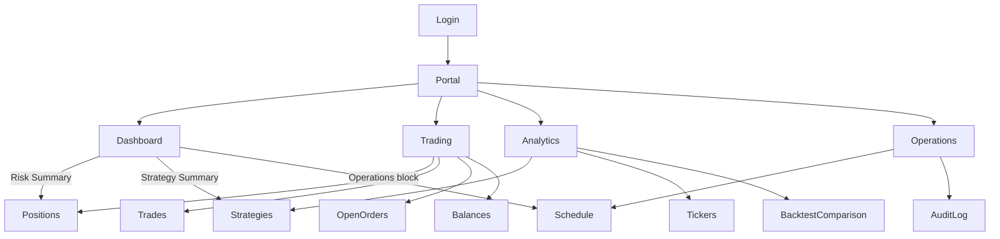

# 画面関係図

文書の役割は [../DOCUMENTATION_STRUCTURE_JA.md](../DOCUMENTATION_STRUCTURE_JA.md) にあります。

この文書は、画面遷移の正本です。英語版 [SCREEN_RELATIONSHIP_DIAGRAM.md](SCREEN_RELATIONSHIP_DIAGRAM.md) が原文です。

どの画面からも注文は出せません。Performance は、Dashboard で運用を読む名前です。別の行き先ではありません。Backtest Comparison は、Analytics の中のページです。

ログインは、Portal の前の門です。五つ目の主な画面ではありません。

## ツリー

```text
Login
  |
  v
Portal
├─ Dashboard
├─ Trading
│   ├─ Positions
│   ├─ Trades
│   ├─ Open Orders
│   └─ Balances
├─ Analytics
│   ├─ Strategies
│   ├─ Tickers
│   └─ Backtest Comparison
└─ Operations
    ├─ Schedule
    └─ Audit Log
```

Portal の直下の四つは、どの画面からでも選べます。Trading、Analytics、Operations の下の名前は、その画面の中の切り替えです。開いても、その画面からは出ません。

## 画面から開く先

画面が、別の画面へ描いているリンクです。同じ画面の中の切り替えは、ここには書きません。

- Dashboard の Risk Summary は、Trading の Positions を開きます。
- Dashboard の Strategy Summary は、Analytics の Strategies を開きます。
- Dashboard の Operations は、Operations の Schedule を開きます。

Trading、Analytics、Operations は、それ以上の飛び先を足しません。外側の移動で、四つの主な画面に戻ります。

## 図



```text
Login
  |
  v
Portal
  |
  +-- Dashboard ---- Risk Summary ------> Trading / Positions
  |     |                                  Analytics / Strategies
  |     |                                  Operations / Schedule
  |
  +-- Trading
  |     |-- Positions
  |     |-- Trades
  |     |-- Open Orders
  |     +-- Balances
  |
  +-- Analytics
  |     |-- Strategies
  |     |-- Tickers
  |     +-- Backtest Comparison
  |
  +-- Operations
        |-- Schedule
        +-- Audit Log
```
